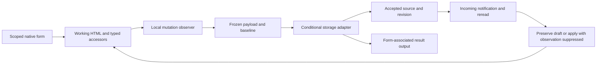

# Document-first development for websites and applications

**Edition:** 2.4 · **First written:** October 14, 2026 · **Revised:** November 4, 2026

**Publisher:** [Pagelove](https://pagelove.com). **Audience:** developers, architects, designers of authoring tools, and technical reviewers. **Scope:** publishing and marketing sites, directories and catalogs, dashboards and analytical apps, workflow and transactional tools, editors, games, and interactive simulations.

This guide explains how to keep an application's information understandable, editable, and reusable as its interfaces change. Its core principles apply across platforms. Appendix B maps them to Pagelove and records the limits of the available implementation evidence.

Readers should understand HTML, URLs, basic JavaScript, HTTP requests, and access control. The primary HTML/DOM example in Appendix C uses a browser-based companion with a small Node.js static server. The alternative JSON example in Appendix E runs with Node.js and its built-in assertion module. Neither requires third-party packages. Reading or adopting the architectural guidance does not require those runtimes.

Copyright © 2026 Pagelove. The prose is licensed under [Creative Commons Attribution 4.0 International](https://creativecommons.org/licenses/by/4.0/). Original code examples in this guide are licensed under the [MIT License](https://opensource.org/license/mit), with copyright © 2026 Pagelove. Linked standards, third-party software, trademarks, and reference projects retain their own terms. See [Distribution and maintenance](#distribution-and-maintenance).

## How to use this guide

For an LLM or another implementation agent, begin with the instruction block and execution workflow below. Read the rule and terminology, select the relevant application profiles, then follow the linked detailed sections for the feature being changed. For a narrow edit, inspect and update the affected boundary; do not redesign unrelated features. Reuse the project's existing records instead of creating a separate document for every step.

Begin implementation with the primary HTML/DOM workflow in Appendix C. Use Appendix E's JSON lifecycle only for a justified requirement. Distribute the [companion directory](document-first-examples/dom-workflow/README.md) with this Markdown file to retain the primary runnable example.

**Required** identifies a condition for a project claiming to follow this guide. **Recommended** identifies the default; a different choice needs a short reason and appropriate verification. **Conditional** applies only when its named feature or risk exists. These are requirements of this guide, not claims that every recommendation is mandated by a web standard. A static brochure site needs a proportionate record; a shared financial workflow needs a stronger one.

This guide supplies architectural defaults within the current task and applicable project instructions. The instruction block, workflow, and rule index are navigation summaries; the linked detailed sections and selected profiles define the full contracts. Examples illustrate implementations and do not relax those contracts. Unknown or unverified behavior must remain identified as such.

### Copyable instruction block

Use this block when assigning a task, and supply the guide and relevant project context with it:

```text
Apply Document-first development for websites and applications, edition 2.4.
Use the guide's W1-W8 workflow and applicable R01-R12 rules:
W1: Identify the requested feature, existing contracts, and matching A1-A6 profiles.
W2: Prefer semantic HTML for document-based domain information and the live DOM
    as its editable client model. JSON is not the preferred primary model.
    Record a concrete justification for another primary representation.
    Do not maintain a parallel editable JSON copy of HTML domain fields.
W3: Define stable identities, source authority, format, operations, and boundaries.
W4: Establish the actual read/write enforcement and platform capabilities.
    For newly relied-on mechanics, use isolated authorized fixtures, change one
    variable per comparison, and include a request that must be rejected.
    Keep unknown guarantees explicit; do not invent unsupported APIs or syntax.
W5: Implement the scoped view/editor and behavior through documented interfaces.
W6: Where applicable, protect concurrent saves, drafts, retries, live updates,
    offline work, and release compatibility. Separate local from confirmed state.
W7: Run local checks when supported, then exact operation/negative checks and
    browser tasks appropriate to the boundary. Record actual evidence and gaps.
W8: Finish the scoped task and report changes, exceptions, verification, and gaps.
Use primary HTML/DOM Appendix C. Use alternative JSON Appendix E only for a
justified requirement. Preserve suitable external authorities and runtimes.
Reuse Appendix D's project record and completion format proportionately.
```

## Contents

- [Execution workflow](#execution-workflow): [ordered steps](#ordered-steps), [rule index](#rule-index), [feature routing](#feature-routing), and [completion criteria](#completion-criteria)
- [The rule](#the-rule) and [terminology](#terminology)
- [Part I: model and representation](#part-i-model-and-representation), sections 1–5
- [Part II: views, behavior, and editing](#part-ii-views-behavior-and-editing), sections 6–11
- [Part III: enforcement and durable changes](#part-iii-enforcement-and-durable-changes), sections 12–14
- [Part IV: experience and resilience](#part-iv-experience-and-resilience), sections 15–18
- [Part V: exceptions, verification, and adoption](#part-v-exceptions-verification-and-adoption), sections 19–23
- [Appendix A: application profiles](#appendix-a-application-profiles)
- [Appendix B: Pagelove mapping and evidence](#appendix-b-pagelove-mapping-and-evidence)
- [Appendix C: primary HTML/DOM workflow](#appendix-c-primary-htmldom-workflow)
- [Appendix D: project record and acceptance checklist](#appendix-d-project-record-and-acceptance-checklist), including the [task completion template](#d4-task-completion-template)
- [Appendix E: alternative JSON lifecycle for justified cases](#appendix-e-alternative-json-lifecycle-for-justified-cases)
- [Standards and guidance](#standards-and-guidance), [distribution](#distribution-and-maintenance), and [revision history](#revision-history)

## Execution workflow

### Ordered steps

Follow W1–W8 for the affected feature. A step can be brief or not applicable with a reason; its position does not require a new subsystem or a new approval. Revisit an earlier decision when new evidence changes it. Record the results once in the project's normal documentation, using [Appendix D1](#d1-minimum-project-record).

| Step | Action | Result to record | Detailed guidance |
| --- | --- | --- | --- |
| W1 — Scope | Inspect the requested change and existing contracts; select every relevant application profile. | Feature boundary, profiles, existing decisions, and material unknowns. | [Incremental adoption](#23-apply-the-preference-incrementally), [profiles](#appendix-a-application-profiles) |
| W2 — Choose representation | Apply the HTML/DOM default to document-based domain information; evaluate an exception only for a concrete requirement. | Source format, editable working model, or exception and reason. | [The rule](#the-rule), [exceptions](#19-allow-justified-exceptions), [costs](#22-understand-why-this-preference-matters) |
| W3 — Define the contract | Identify entities, authority, stable IDs, relationships, bounds, versions, and supported operations. | Model, format, authority map, and consistency boundary. | [Part I](#part-i-model-and-representation), [relationships](#relationships-and-consistency) |
| W4 — Establish enforcement | Check actual paths, permissions, validators, and concurrency before enabling a newly relied-on operation. Use isolated fixtures, one-variable comparisons, and negative controls. | Exact request/build, supported guarantees, rejected invalid case, and explicit gaps. | [Persistence boundary](#12-enforce-validity-and-authority-at-the-persistence-boundary), [platform selection](#18-prefer-native-platform-capabilities-after-checking-their-suitability) |
| W5 — Build the interaction | Connect permitted source views, modules, scoped controls, and meaningful status through documented interfaces. | Source provenance, bindings, commands/results, and accessible task paths. | [Part II](#part-ii-views-behavior-and-editing), [accessibility](#15-support-accessible-and-progressively-enhanced-experiences), [primary example](#appendix-c-primary-htmldom-workflow) |
| W6 — Handle interruption and change | Apply the relevant draft, conditional-save, retry, incoming-update, offline, migration, and recovery contracts. | State transitions, recovery path, duplicate policy, and release compatibility. | [Recoverable edits](#13-make-edits-deliberate-and-recoverable), [releases](#14-separate-application-releases-from-user-managed-content), [synchronization](#17-make-offline-behavior-and-synchronization-explicit) |
| W7 — Verify | Use available local composition/shape gates, exact client requests, negative/concurrent controls, stream checks where applicable, and a separate browser task pass. | Check, revision/environment, result, evidence, and limitations. | [Budgets](#16-design-for-the-performance-characteristics-of-the-application), [evidence](#20-require-evidence-that-the-architecture-works-as-intended), [acceptance checks](#d2-acceptance-checks) |
| W8 — Complete and explain | Reconcile the implemented change, project record, applicable checks, and remaining work. | Concise completion record with explicit exceptions and gaps. | [Maintainable explanation](#21-explain-the-architecture-in-terms-that-support-future-learning), [completion template](#d4-task-completion-template) |

### Rule index

Use these stable IDs when recording a decision or review finding. This is an index to the detailed requirements, not an exhaustive substitute for reading an applicable section.

| ID | Applies when | Rule summary | Detailed guidance |
| --- | --- | --- | --- |
| R01 | Choosing a document-based domain representation | Prefer semantic HTML and DOM-backed editing. JSON primary models need a recorded justification; derived output or packaging must not become a competing editable authority. | [The rule](#the-rule), [structure](#3-make-structure-and-meaning-explicit), [exceptions](#19-allow-justified-exceptions) |
| R02 | Defining or changing entities | Use explicit types/properties, stable identities, bounded formats, and a declared unknown/future-version policy. | [Domain model](#1-start-with-the-subject-matter-of-the-application), [format](#3-make-structure-and-meaning-explicit), [identity](#5-give-resources-stable-identities) |
| R03 | Using several representations or editing state | Name the authority and derivation; distinguish baseline, draft, pending, accepted, and historical states. Materialized derived fields retain authoritative inputs and a convergent maintenance policy. | [Authority](#4-establish-one-authoritative-source-for-each-kind-of-information), [editors](#11-treat-editors-as-views-over-the-application-model) |
| R04 | Choosing resource or transaction boundaries | Bound aggregates and enforce ownership, references, moves/deletes, and cross-resource invariants with a mechanism that supplies the promised consistency. | [Resources](#2-treat-documents-as-application-resources), [relationships](#relationships-and-consistency) |
| R05 | Composing or routing views | Resolve source identity and permission deliberately; an editable view must identify its supported mutation target and origin. | [Composition](#6-use-native-composition-and-routing-where-they-fit), [provenance](#7-preserve-the-connection-between-a-composed-view-and-its-source) |
| R06 | Adding behavior, extensions, or editors | Use explicit module and command/result contracts; scope forms to valid targets, serialize current values, and keep temporary UI outside persisted domain content. | [Responsibilities](#8-separate-meaning-presentation-and-behavior), [interfaces](#9-attach-behavior-through-explicit-interfaces), [extension](#10-make-extension-a-designed-capability), [editors](#11-treat-editors-as-views-over-the-application-model), [serialization](#3-make-structure-and-meaning-explicit) |
| R07 | Reading protected information or accepting writes | Enforce the actual path's authorization and validation. Client declarations, discovered grants, and trusted authoring are not interchangeable enforcement boundaries. | [Validity and security](#12-enforce-validity-and-authority-at-the-persistence-boundary), [platform evidence](#18-prefer-native-platform-capabilities-after-checking-their-suitability) |
| R08 | Saves can conflict, fail, repeat, or have an ambiguous outcome | Use supported atomic concurrency control, frozen pending payloads, retained drafts, and a declared receipt/reconciliation policy. Local acceptance is not confirmation of shared persistence. | [Recoverable edits](#13-make-edits-deliberate-and-recoverable), [offline state](#17-make-offline-behavior-and-synchronization-explicit) |
| R09 | Delivering user-facing tasks | Verify semantic controls, keyboard paths, focus, errors, status, and applicable accessibility requirements for the complete task. | [Accessibility](#15-support-accessible-and-progressively-enhanced-experiences), [profile tasks](#appendix-a-application-profiles) |
| R10 | Offline work or live incoming updates exist | Define storage and subscription lifecycle, permissions, gaps/resets, and recovery. Incoming application must not re-save itself or silently overwrite dirty work. | [Synchronization](#17-make-offline-behavior-and-synchronization-explicit), [incoming updates](#incoming-changes-and-subscription-lifecycle) |
| R11 | Releasing code, changing formats, or migrating information | Preserve mutable user information, define version compatibility, and verify restoration or forward repair for consequential changes. | [Releases](#14-separate-application-releases-from-user-managed-content), [acceptance](#d2-acceptance-checks) |
| R12 | Claiming the changed feature is ready | Record budgets/support, exact-path and negative-control evidence, separate browser results, and meaningful limits; pending checks do not pass. | [Performance](#16-design-for-the-performance-characteristics-of-the-application), [evidence](#20-require-evidence-that-the-architecture-works-as-intended), [explanation](#21-explain-the-architecture-in-terms-that-support-future-learning) |

### Feature routing

Use all matching rows. Select workload profiles separately: [A1 publishing](#a1-publishing-marketing-documentation-and-content-sites), [A2 directories](#a2-directories-catalogs-marketplaces-and-searchable-collections), [A3 analytics](#a3-dashboards-reporting-and-analytical-applications), [A4 workflows](#a4-workflow-business-registration-and-transactional-tools), [A5 editors](#a5-editors-creative-tools-builders-and-authoring-applications), and [A6 games/simulations](#a6-games-and-interactive-simulations). Mixed products use several profiles.

| Feature or constraint | Read next | Application decision |
| --- | --- | --- |
| Read-only content or results | [Part I](#part-i-model-and-representation), [views](#6-use-native-composition-and-routing-where-they-fit), [experience](#15-support-accessible-and-progressively-enhanced-experiences) | Apply source, derivation, access, and freshness contracts. Editor, write, and live-update requirements apply only if those features exist; protected reads still need section 12. |
| Editable HTML information | [Primary Appendix C](#appendix-c-primary-htmldom-workflow), [editors](#11-treat-editors-as-views-over-the-application-model) | Declare the persisted root, typed/scoped bindings, temporary UI boundary, and local/pending/accepted states. |
| Shared or consequential writes | [Enforcement](#12-enforce-validity-and-authority-at-the-persistence-boundary), [recoverable edits](#13-make-edits-deliberate-and-recoverable) | Establish supported authorization, validation, atomicity, concurrency, and recovery. If the required guarantee is unavailable, leave that operation unsupported and record the gap. |
| Composed editable views | [Provenance](#7-preserve-the-connection-between-a-composed-view-and-its-source), [platform evidence](#18-prefer-native-platform-capabilities-after-checking-their-suitability) | Resolve actor, addressed view, origin, selector, validator, and version scope; keep ambiguous targets read-only. |
| Offline drafts or live collaboration | [Synchronization](#17-make-offline-behavior-and-synchronization-explicit), [primary example limits](#c3-exercise-and-evidence) | Distinguish draft storage from confirmed writes; define incoming/outgoing separation, gaps/resets, account scope, and recovery. |
| Required JSON integration or existing external authority | [Exceptions](#19-allow-justified-exceptions), then [alternative Appendix E](#appendix-e-alternative-json-lifecycle-for-justified-cases) | Record the actual constraint first. Preserve the established authority and avoid an independently editable HTML/JSON duplicate. |
| Dense data, media, simulation, or another specialized runtime | [Exceptions](#19-allow-justified-exceptions), [budgets](#16-design-for-the-performance-characteristics-of-the-application), matching profile | Keep the suitable runtime/representation; document its authority and source/conversion relationship. Do not force every value into the DOM. |
| Release or stored-format change | [Releases](#14-separate-application-releases-from-user-managed-content), [recovery checks](#d2-acceptance-checks) | Define compatibility and protect existing information before migration or replacement. |
| Pagelove record views or deployment | [Record/view pattern](#b2-record-documents-and-composed-views), [enforcement](#b3-verify-the-enforcement-triangle), [verification sequence](#b5-local-and-deployed-verification-sequence) | Verify deployed mechanics against dated evidence; distinguish data creation, routed edits, authoring, and subscriptions. |

### Completion criteria

Complete the requested scope, update the existing project record where relevant, and report the actual verification result. Use [D4](#d4-task-completion-template) as a compact handoff format. Each applicable acceptance check is pass, fail, pending, or not applicable with a reason. Explain a material unresolved decision instead of inventing a guarantee; continue independent work that does not depend on it. A narrow successful change does not establish conformance of the entire project, and a local fixture does not establish deployed behavior.

## The rule

Prefer an architecture in which durable domain information and editable configuration have structured, addressable representations with explicit ownership, validation, and lifecycle rules.

Identify the information, its relationships, and the operations people need before choosing interface components or a rendering engine. Prefer semantic HTML for document-based domain information, alongside native content and controls, stable identities, and explicit behavioral interfaces. Choose storage, composition, and processing mechanisms that can enforce the required contracts.

**Make meaningful information independently understandable, addressable, and reusable; connect presentation and behavior through clear, replaceable interfaces.**

Document-first is an architectural preference. It does not require HTML for every value, one file per object, a particular database, or document storage inside an animation loop. Existing authoritative systems, binary assets, transactional stores, and efficient generated representations are appropriate when their ownership and relationship to the model are clear.

**Recommended default:** prefer semantic HTML for document-based domain information and the live DOM as its editable client working model. **JSON is not the preferred primary domain representation in this guide.** Typed accessors and scoped forms should operate on the HTML structure directly, with adapters persisting validated snapshots or semantic operations. A local mutation remains unconfirmed until the authoritative boundary accepts it.

**Required for an alternative representation:** record the concrete requirement and why the HTML/DOM approach cannot suitably meet it, using the exception record in section 19. Examples include required JSON interchange, external integrations or existing authoritative systems, and workloads needing a specialized representation. Do not duplicate editable HTML domain information in a parallel editable JSON model. JSON used for transport envelopes, revision metadata, draft packaging, or rebuildable output does not establish another editable domain authority; document its role and derivation.

## Terminology

| Term | Meaning in this guide |
| --- | --- |
| Entity | A meaningful domain concept, such as an article, listing, measurement, approval, scene, or quest. |
| Resource | Information addressed through a stable application identifier or URL. Addressability does not imply public access. |
| Source document | The authoritative stored representation of one resource or a deliberately bounded aggregate. Semantic HTML is preferred for document-based domain information; JSON or another format requires a documented exception. |
| Aggregate | Related entities updated within one consistency boundary, such as a workshop and its owned sessions. |
| Representation | A serialization or view of a resource. Several representations can describe the same entity. |
| Composed view | Output assembled from sources and templates. Its DOM is an interface representation, not automatically an editable source. |
| DOM-backed working model | A declared editable DOM subtree representing domain information, accessed through documented interfaces and linked to a confirmed source revision. |
| Local mutation | A change to working information that may still be pending, rejected, or recoverable as a draft. It is not evidence of an accepted write. |
| Derived representation | A rebuildable index, report, cache, rendered page, or runtime bundle with recorded provenance. |
| Draft or runtime state | Work in progress or transient execution state with a lifecycle distinct from published information. |
| Schema / shape | A declaration of allowed information or markup. Its enforcement depends on a validator and the write path that invokes it. |
| Persistence boundary | The operation that decides whether a change becomes authoritative, including its authorization and concurrency checks. |
| Trusted authoring | A privileged path for maintaining application resources. It may intentionally bypass application validation. |
| Application mutation | A supported end-user or automated operation constrained by the application's rules. |

## Part I: model and representation

Define the subject, resource boundaries, source format, authority, and stable identity before connecting views.

### 1. Start with the subject matter of the application

Describe entities in the language of their users. An article has an author and publication state; a listing has an owner and review status; a metric has a definition and observation period; an approval has a requester and decision; a design has layers; a game has definitions and play state.

**Required:** identify properties, relationships, lifecycle, ownership, read access, editable fields, and meaningful operations. Distinguish authoritative, derived, and temporary values. State which external systems already own information; importing their data does not transfer that authority.

Classify state before implementation:

| State class | Examples | Design obligation |
| --- | --- | --- |
| Authored definitions | Articles, catalog entries, report definitions, workflow rules, scenes, levels | Editing, versioning, validation, publication, and ownership. |
| Shared operational records | Submissions, approvals, bookings, saved designs, accepted game results | Authorized transitions, consistency, concurrency, recovery, and retention. |
| Derived output | Search results, aggregates, previews, rendered pages, engine bundles | Source revisions, generation rules, freshness, and rebuildability. |
| Local working state | Unsaved forms, filters, selections, pending uploads, simulation positions | Clear lifetime, recovery expectations, and separation from confirmed state. |

A feature-sized explanation is sufficient for a small site. A substantial app should maintain a model and operation inventory. Appendix A adds domain-specific obligations without requiring every project to implement every feature.

### 2. Treat documents as application resources

Choose boundaries around ownership, lifecycle, access, read patterns, and atomic changes. Related entities can share a document when they need to change together. Independently managed resources should have their own boundaries when that separation creates a practical benefit.

For example, `/resources/workshops/workshop-001` can identify the source used by `/workshops/autumn-workshop`, `/calendar`, and `/editor/workshops/workshop-001`. Slugs and view URLs can change while the entity retains its identity. These illustrative paths do not prescribe a platform routing syntax.

**Required:** define the supported read and write operations, maximum aggregate size, deletion policy, and consistency boundary. If an invariant spans separately stored documents, identify the transaction, conditional coordination, or authoritative service that maintains it. A sequence of successful individual writes does not by itself make an operation atomic.

Avoid manually maintaining authoritative copies in every view. A publication snapshot or historical invoice may deliberately retain an immutable copy; document its purpose and distinguish it from the currently editable source. Keep private attributes out of public resource projections.

Prefer owned, ordered collections when entries share an owner and lifecycle; retain explicit references when entities are independently managed. Define what each position means. For a participant, observation, or approval step added after a process starts, specify alignment, backfill, missing entries, and removal behavior. Do not silently infer relationships from equal array positions. One document per independently owned record is a useful pattern, not a requirement for every nested item.

### 3. Make structure and meaning explicit

Use headings, lists, links, tables, forms, and buttons for their native meanings. Prefer machine-readable properties in the same semantic HTML that represents the domain information; HTML microdata is standardized. A custom vocabulary needs stable names and documented semantics. Choose JSON or another representation only for a justified requirement such as required interchange, integration with an existing authority, or a specialized workload, and record the exception under section 19. Convenience with a client framework alone does not justify maintaining a second editable domain model. [HTML microdata][html-microdata]

This illustrative public event projection uses Schema.org terms:

```html
<article id="event-card-workshop-001"
         itemscope itemtype="https://schema.org/Event"
         itemid="https://example.org/records/workshop-001">
  <h2 itemprop="name">Autumn workshop</h2>
  <p itemprop="description">A practical editing workshop.</p>
  <time itemprop="startDate" datetime="2026-11-12T15:00:00Z">
    November 12, 2026, at 15:00 UTC
  </time>
  <p>Location: <span itemprop="location">Online</span></p>
</article>
```

Schema.org permits text for `location`; a `VirtualLocation` with a public attendance URL can convey more information when appropriate. Do not expose private joining credentials through public markup. This projection is an illustration, not a complete event interchange or search-result eligibility specification. [Schema.org location][schema-location]

**Required:** publish a format contract covering:

- Entity types, vocabulary identifiers, format version, required fields, cardinality, and allowed values.
- Numeric units and precision, timezones, text language, ordering, and the difference between absent, empty, false, and zero.
- Reference resolution, base URLs, ownership, and duplicate property or identifier handling.
- Limits on bytes, nesting, collections, and computationally expensive inputs.
- Parser and serializer behavior, including normalization and round-trip expectations.
- Unknown fields, capabilities, and future versions: preserve them safely or reject the operation explicitly; never silently discard information on save.

Separate machine values from localized display strings. A metric's stored quantity should not be parsed from a label such as “1,234.50”; a business schedule may require a named timezone in addition to an instant. Validate persisted and imported data, even when a browser can parse or display it.

**Conditional for HTML-backed editing:** declare the persisted subtree and distinguish domain markup from selection, focus, validation messages, drag indicators, and other temporary interface changes. Observe only the intended root and relevant mutations. A mutation observer reports DOM changes; it cannot determine their business meaning, permission, or transaction boundary. [DOM mutation observers][mutation-observer]

Specify how current form state becomes serialized information. An input's current `.value` can differ from its `value` attribute; checked and selected states have related distinctions. Serializing `outerHTML` alone can therefore save stale form defaults. Copy current values into the declared source representation or serialize them explicitly, validate the result, and test round-trips. Keep credentials and temporary controls outside exported source. [HTML input value][input-value]

### 4. Establish one authoritative source for each kind of information

Document the authority for each field or aggregate, scoped to its purpose. A payment provider may own settlement, an editorial source may own article text, and a reporting service may own a calculated metric. Define transformations and reconciliation when these interact.

For every important representation, record its source identities and revisions, whether it can be edited, how edits reach the source, when it is refreshed, how staleness is recognized, and how it is rebuilt. Avoid generation cycles in which a derived artifact is needed to reconstruct its own source.

**Required:** distinguish published content, drafts, live records, and historical snapshots. An application may intentionally pin a report, approval, order, or game session to a particular definition revision. Show the provenance needed to interpret that result later.

A rebuildable JSON bundle, database projection, search index, or GPU buffer can be derived from the preferred HTML source when a consumer needs it. Record a traceable transformation and unambiguous authority, and regenerate derived information instead of editing it independently. Retain an existing external authority when converting it would break its contract; record that representation as an exception.

#### Derived values in the artifact

Keep authoritative inputs, calculation rules/revisions, and materialized results distinguishable. Store the inputs needed for later editing or reproduction, and identify their authority in the contract/schema description. View-only totals and ordinals normally belong outside the persisted subtree; CSS counters can express suitable ordinals without mutating it. A result that belongs on a saved or printed artifact may be materialized inside it with an explicit maintenance policy.

Use stale-only writes so repeated maintenance converges:

```js
if (cell.textContent !== String(value)) cell.textContent = String(value);
```

This guard prevents a redundant local text write; it does not establish conflict safety or trusted calculation. Define dependency order, rounding, invalid inputs, normalization, and what happens when several clients calculate from different revisions. Verify a second normalization pass makes no change. Observe the actual persistence request: a small computed change can cause a client to serialize the nearest ancestor with a PUT grant. Accept that scope only when its validation, concurrency and information-preservation contracts hold. Client-computed results used for consequential decisions still need authoritative verification.

Prefer typed entity access and collection traversal over a DOM-backed editor's working subtree, avoiding a parallel editable JSON copy of its domain fields. Define missing fields, cardinality, coercion, live versus snapshot collections, and validation before writes. Such accessors are application or library interfaces; microdata does not give arbitrary native elements a typed `.value` API. Keep the confirmed baseline, pending serialized snapshot, and recovery copies distinct from that working subtree. Appendix C is the primary example of this approach. Appendix E illustrates a separate parsed JSON model only for a justified exception.

### 5. Give resources stable identities

Distinguish entity identity, source address, public or editor view address, DOM element ID, and revision. Display text, sort order, CSS classes, and transient component instances should not determine persistent identity. Define rename, move, redirect, deletion, and identifier-reuse policies.

**Required:** preserve identity through supported migrations and exports, and scope tenant-local identifiers unambiguously. Check permission after resolving the resource; an unguessable identifier is not an access-control policy.

The same record can appear in a card and an editor. Give those elements different DOM IDs, such as `workshop-001-card` and `workshop-001-editor`, while retaining the same underlying entity identifier. HTML IDs must be unique within their tree. Microdata `itemid`, where the vocabulary supports it, identifies the represented item separately from its element. [HTML IDs][html-id], [microdata item identity][html-microdata]

When composition moves fragments, preserve resource identity and resolve relative references deliberately. Repeated instances need instance-specific labels, control IDs, and fragment links as well as provenance back to their source.

When a query spans the whole site, use a site-unique record key or constrain it by source resource and verify one match; an HTML ID is otherwise unique only within its tree. Give items appended by custom code stable IDs explicitly, even if a particular bound-form library mints them automatically. Positional selectors are fragile under reorder, concurrent edits, and composition.

Cloned picker/reference content is a derived view. Remove unused cloned IDs or mint instance-specific replacements, updating label, ARIA, fragment, and other ID references together. Preserve the represented entity/source identity separately. Keep those display clones outside the authoritative edit scope unless the user explicitly creates a new entity or a declared immutable snapshot.

For collection editing, define whether order and containment carry domain meaning. Moving an existing DOM node can preserve its client identity and listeners; cloning it creates another instance and requires deliberate identifier handling. Persist a same-entity move as a move or an atomic aggregate change when that is the contract. Two observed remove/insert records do not by themselves justify a destructive delete followed by creation. A DOM mutation batch does not establish a server transaction.

## Part II: views, behavior, and editing

Connect composition, provenance, modules, commands, extension, and editing to the model.

<a id="6-use-pageloves-native-composition-and-routing-where-they-fit"></a>

### 6. Use native composition and routing where they fit

Evaluate the platform's routing and composition before implementing another layer. Use templates for shared structure and sources for independently varying information. Appendix B describes Pagelove-specific mechanisms; these are separate from standard browser behavior.

**Required:** define route matching and precedence, parameter validation, resource resolution, missing-resource responses, permission checks, and failure behavior. An unknown listing, project, report, or level should not silently select a different record. Avoid inserting untrusted route values into selectors, paths, queries, or executable templates.

Specify whether composition is server-side, build-time, or client-side, and which methods and request forms invoke it. Record cache dependencies and invalidation when an included source changes. Bound inclusion depth, cycles, fan-out, and time spent resolving sources.

For protected views, evaluate both the shell and included information. Verify direct-source reads, composed reads, previews, errors, and exports against the same disclosure policy. Local preview is useful but may not reproduce the deployed host's behavior.

### 7. Preserve the connection between a composed view and its source

A developer should be able to identify the origin, revision, and intended update target of meaningful content. A rendered fragment or browser edit does not automatically carry authority to modify its source.

**Required for editable composition:** record the full mutation path: addressed resource and selector, resolved origin, actor, authorization decision, validator, version precondition, atomic update boundary, and returned confirmation. Distinguish checks on the composed page from checks on the originating resource. Verify that alternate paths cannot broaden the intended access.

Use explicit source identities in editor bindings or a supported platform provenance mechanism. If provenance is ambiguous, make that view read-only until it can resolve a valid target. Handle deleted or changed sources as recoverable conflicts rather than redirecting the edit to a similar-looking element.

Composition and mutation require independent verification. Pagelove documents authorization on the addressed composed page and shape/version checks at the origin. Confirm this split for the deployed path; see Appendix B.

For a stamped record view, keep the record's editing affordances with its source when that preserves the platform's origin mapping. A template that renders similar-looking new markup may produce a derived view without the same write-through link. Test the chosen mechanism and the exact selector write, rather than inferring editability from visual equivalence. Controls remain subject to authorization regardless of where their markup is stored.

### 8. Separate meaning, presentation and behavior

| Layer | Responsibility |
| --- | --- |
| Domain contract | Entities, properties, relationships, permissions, invariants, and transitions. |
| Source documents and storage adapter | Authoritative representation, durable writes, concurrency, and declared enforcement. |
| Composition and projections | Assemble permitted views and record derivation and freshness. |
| CSS and interface markup | Present content and controls with meaningful states and accessible relationships. |
| Application behavior | Coordinate commands, computation, interactions, and temporary state. |
| Specialized runtime | Perform analytical, graphical, media, or simulation work in an appropriate representation. |

The layers can cooperate closely. A visible status label may reflect a workflow state; a chart may reflect a metric definition; an editor treatment may reflect an object's capability. Preserve that meaning in the model rather than encoding it solely in color or layout.

**Recommended:** maintain a shared contract or compatible validators for editors, imports, builds, and server operations. Sharing client validation code does not establish that the server actually executes it. Keep rendering dependencies out of the domain contract when that makes independent validation and reuse practical.

For DOM-backed applications, useful independent modules cover typed access/schema, scoped forms, outgoing persistence, incoming subscriptions, and status presentation. Each should have an explicit initialization, error, and disposal contract. Test the model with a storage fixture, persistence without drag behavior, and subscription application without re-saving it. Declarative schema and binding syntax belong to a named implementation with a versioned contract. Treat compiled binding expressions or transformations as trusted application code; never compile untrusted content as executable configuration.

When client and server consume shared schema declarations, test parity on valid, invalid, unknown, and future-format fixtures. Record any differences in coercion, defaults, transitions, and supported constraints. A shared declaration is useful only to the extent that each actual write path enforces its relevant rules.

### 9. Attach behavior through explicit interfaces

Name commands and completed facts separately: `request-approval` and `approval-recorded`, `publish-requested` and `publication-confirmed`, or `move-requested` and `move-accepted`.

**Required for shared interfaces:** document the producer and consumer, payload and version, actor and entity identifiers, preconditions, validation, ordering, cancellation, completion, failure, timeout, and duplicate-delivery policy. Use named functions, modules, registries, messages, or events according to the problem.

For DOM events, specify `bubbles`, `cancelable`, and `composed` where relevant. Dispatch calls listeners synchronously; asynchronous work started by a listener needs its own completion contract. Use a promise-returning command or explicit completion message when callers must await persistence. A successful dispatch is not a successful save. [DOM event dispatch][dom-events]

Use one status contract across supported editors: idle, locally changed, pending, confirmed, rejected, conflict, and disconnected where applicable. A reusable controller can route results by form and operation ID to a native `output` associated through `for`. Define suitable status announcements and field-specific errors; retain errors until they can be acted on and avoid announcing every keystroke. The `output` element and association are native HTML; controller event names and routing are application-defined. [HTML output][html-output], [WAI forms guidance][forms]

For external effects such as mail, payments, or integration callbacks, use an explicit delivery and reconciliation policy. Conditional: couple accepted state changes and outgoing work through a transactional outbox or equivalent supported mechanism when losing one without the other would violate the product's contract. Never promise exactly-once external execution solely because a client retries with the same identifier.

### 10. Make extension a designed capability

Start with bounded configuration and trusted registries. A schedulable article, verified listing, aggregatable metric, approvable request, exportable scene, or moving game object needs an implemented capability contract.

For example, define `https://example.org/capabilities/schedulable/v1` with required fields `publishAt` and `publicationTimezone`, permission `schedule`, a precondition that publication checks pass, and a completed fact `publication-confirmed`. It conflicts with an immediate-only publication policy. The scheduler must have an identified execution service and retry policy; naming the capability does not create a background scheduler.

**Required:** declare properties, defaults, dependencies, conflicting capabilities, execution order, version compatibility, resource limits, and failure behavior. Validate dependency graphs and reject cycles or unsupported combinations. Record which extensions may affect security, numerical results, or compatibility with saved state.

Unrecognized executable capabilities should not run. Preserve the original import or provide read-only recovery when the editor cannot safely round-trip a newer definition. Arbitrary scripts require an explicit sandbox, trust model, privileges, resource budget, and review; ordinary content must not activate privileged code or platform configuration.

### 11. Treat editors as views over the application model

Editors, bulk tools, imports, and automated clients should use the same published contract. Internal editing formats are acceptable with defined conversions, validation, and preservation of supported information.

**Required:** distinguish published baseline, draft, pending command, confirmed save, and rejection or conflict. Preserve local work on failed or ambiguous saves. Identify the snapshot submitted if someone continues editing during a save. Do not present an attempt or local storage write as confirmation of shared persistence.

Provide undo/redo, preview, draft recovery, and export where their absence would make ordinary mistakes costly. Preview should identify its content revision and differences from publication, such as disabled external effects. Bulk operations need per-item outcomes or a clearly atomic result.

A reusable native form can create or edit an entity when it resolves a supported type, explicit collection or stable entity ID, and allowed properties. Resolve within the declared source root; reject missing or ambiguous targets. Validate the whole command before changing any field. Cancellation must not leave a partial edit. Exclude form controls and status from persistence unless the format intentionally stores them. Declare whether opening a dialog copies values into a draft or edits the working model immediately, and preserve focus and accessible labels across open/close and save outcomes.

#### Dialogs, compound fields, and reference pickers

Populate an editor from the current stored values before it becomes interactive. Initialize synchronously before a programmatic dialog open, or at a verified native-invoker activation point; cover keyboard activation and every other opening path. A capturing click handler on a supported invoker can supply that hook, with toggle handling as a fallback where verified. Do not assume a late toggle event alone supplies timely prefill. Parse supported legacy and current representations, reset absent/inapplicable controls, and clear disabled alternatives so a prior item's values cannot leak into the next edit. Verify these tasks in the target browser. [HTML dialogs][html-dialog]

When several controls edit one property—for example amount plus currency, date plus timezone, or rank plus category—use a custom command handler if a generic binding cannot express the conversion clearly. Let that handler own parsing, complete-command validation and canonical serialization, without adding a competing hidden model merely to satisfy a form library.

For substantial reference choices, derive searchable or paginated pickers from ordinary readable reference documents. Reuse their meaningful table/list structure rather than maintaining a parallel hard-coded options catalog. Record the source revision and refresh policy; a clone is a snapshot and can become stale. Correct cloned IDs and references as section 5 requires. Provide explicit Add actions, keyboard/focus behavior, and a live result output; keep the picker open for repeated additions when useful. Use this pattern across suitable categories, while retaining simpler native controls for small choices and preserving the reference's appropriate semantics.

For visual, content, and media editors, review both the editor's accessibility and its ability to preserve and help authors create accessible output. ATAG 2.0 provides guidance for this distinction. [Authoring Tool Accessibility Guidelines][atag]

## Part III: enforcement and durable changes

Establish the real acceptance boundary, recoverable operations, and compatibility of saved information.

### 12. Enforce validity and authority at the persistence boundary

**Required:** identify every write path and the checks it actually executes. Separate end-user application mutations, privileged authoring, imports, administrative repair, integrations, and migrations. No application guarantee should silently depend on all callers choosing a well-behaved editor.

Enforce structural validity, allowed state transitions, protected fields, ownership, and applicable relationship constraints where changes become authoritative. Client validation supplies feedback. A privileged authoring bypass can be an intentional trust boundary, but must be identified and covered by authoring review, validation, and recovery procedures. Appendix B records the dated Pagelove authoring evidence and the requirement to re-establish current enforcement.

**Conditional for runtime capability discovery:** obtain supported operations for the current actor, resource, and fragment scope before enabling shared writes. A platform may use OPTIONS plus an application-specific permission description. Define discovering, ready, read-only, denied, and failed states; distinguish an advertised method from permission on a selected entity. A template or writable-looking control cannot grant authority. Recheck authorization on every accepted write and subscription, including after revocation or session expiry. Discovery failure should leave a useful read-only view and explain how to retry. [HTTP OPTIONS][http-semantics]

#### Relationships and consistency

Define reference target types and existence, cardinality and uniqueness, ownership, and move/delete behavior. A session may belong to one workshop; an order may reference a product while preserving the purchased description and price; an approval may require a specific policy revision.

Checking a reference and writing later can race with deletion. Use a supported transaction, coordinated conditional operation, or a single aggregate when the invariant must remain true atomically. Reject the operation if the required guarantee cannot be supplied. A reconciler is suitable only when the product explicitly permits temporary inconsistency and defines detection and repair.

In the primary Appendix C example, one version covers the bounded HTML board and a field edit plus movement commits together. In Appendix E's alternative JSON example, owned sessions live inside the workshop aggregate, their IDs are unique, and deletion is rejected while sessions remain. Independently stored sessions would require additional coordination. An existence-shaped URL or per-document schema cannot supply that coordination by itself.

#### Security and confidentiality

Maintain a proportionate threat model and verification baseline, using a pinned version of OWASP ASVS where appropriate. This edition references ASVS 5.0.0. Record the chosen requirements and any justified exclusions; referencing ASVS is not a security assessment. [OWASP ASVS][asvs]

Check read, list, create, update, delete, publish, export, and administrative actions against the actor, resource, tenant, and current state. Apply authorization to resolved targets and to alternative access paths, including direct documents and derived views. Minimize exposed information in errors and logs. [OWASP authorization guidance][authorization]

Treat imported markup, URLs, embedded content, uploads, and extension settings as untrusted input. Use context-appropriate output encoding and a maintained sanitizer for allowed rich HTML; an HTML parser alone is not a sanitizer. Restrict executable markup and unexpected composition or policy directives. CSP can add defense in depth. [OWASP XSS prevention guidance][xss]

Conditional: address CSRF for cookie-authenticated writes, session expiry, upload type/size checks, traversal and injection in resource selection, and SSRF when the server fetches user-selected URLs. CORS does not grant application permission. Keep credentials in appropriate protected storage and exclude them from distributed documents, previews, bundles, and telemetry. [OWASP CSRF prevention guidance][csrf]

Define classification, retention, deletion, backups, and permitted export for private data. Authorization changes must affect caches and indexes within a stated window. Use suitable HTTP cache policies for public and personalized responses, plus separate policies for application-managed caches. [HTTP caching][http-caching]

### 13. Make edits deliberate and recoverable

Target the intended resource or supported fragment, and protect every operation that can conflict, including partial edits. Define whether a version precondition covers the entire source, an aggregate, or a fragment. For composed writes, establish how it corresponds to the origin's version.

**Required for concurrent editing:** use an atomic conditional update or equivalent concurrency control. With HTTP entity tags, `If-Match` uses strong comparison; a weak ETag is unsuitable for this condition. Preserve the draft and show a reconciliation path after a stale precondition. [HTTP semantics, conditional requests][http-semantics]

Illustrative HTML application endpoint contract following the preferred representation:

```http
GET /resources/workshops/workshop-001 HTTP/1.1
Accept: text/html

HTTP/1.1 200 OK
ETag: "workshop-17"
Cache-Control: private, no-store
Content-Type: text/html; charset=utf-8
```

The response body contains the source representation. After editing, the client sends that complete representation to a supported application endpoint:

```http
PUT /resources/workshops/workshop-001 HTTP/1.1
Content-Type: text/html; charset=utf-8
If-Match: "workshop-17"

<article id="workshop-001" itemscope itemtype="urn:Example:Workshop">
  <h1 itemprop="title">Revised autumn workshop</h1>
  <!-- ... all remaining required fields and owned sessions ... -->
</article>
```

The abbreviated HTML body illustrates the exchange, not a complete schema-valid payload. A real write includes the complete representation required by its endpoint. The same conditional guarantees apply when a justified integration requires JSON; Appendix E covers that alternative. The endpoint applies authentication, authorization, validation, and atomic comparison before committing. A stale precondition produces `412 Precondition Failed`; a missing required precondition can produce `428 Precondition Required`. The latter is defined separately in RFC 6585. This HTTP contract illustrates an application adapter, not Pagelove WebDAV validation. [RFC 6585][http-additional-status]

After a timeout, the outcome may be unknown. Re-read the authoritative resource or consult a durable operation receipt before resubmitting a non-idempotent action. Define retry keys and duplicate handling for creates and external effects; scope receipts to the actor and operation and retain them for the promised retry window. A matching current value alone may not prove which actor's command succeeded.

#### From DOM changes to supported operations

An observer-based adapter needs a declared mapping; standard DOM mutation records are not a storage protocol. The following is an illustrative mapping when the target platform supports it:

| Domain change | Possible adapter operation | Required qualification |
| --- | --- | --- |
| Change an existing field or entity | PUT of the supported representation, or a defined partial-update endpoint | Identify the target and version scope; PUT normally replaces its addressed representation. |
| Add an entity to a collection | POST to a supported collection endpoint | Define assigned identity, validation, duplicate handling, and returned source revision. |
| Remove an entity | DELETE of its supported resource or fragment | Enforce ownership, references, deletion policy, and concurrency. |
| Move the same entity | Supported MOVE or a conditional aggregate replacement | Preserve entity identity and constrain both source and destination. |

MOVE is a WebDAV extension, not a core HTTP method. Selector headers, fragment-write semantics, and automatic fallback are platform-specific contracts. A conditional parent PUT can be appropriate for a small bounded aggregate. It must cover all affected information atomically; separate source and destination replacements can expose loss or duplication. If a platform cannot provide the required guarantee, reject the operation or adopt an explicitly permitted reconciliation design. [HTTP semantics][http-semantics], [WebDAV MOVE][webdav]

Freeze each pending payload with its baseline revision and operation ID. Changes made while it is in flight belong to a later draft. Accepting the earlier snapshot must not mark newer fields as saved. Persist recovery data before risking its loss, handle storage failure explicitly, and keep it after rejection. A memory-only retry queue does not provide recovery after reload.

Test any follow-up read a client performs after MOVE, not just the mutation itself. A selector re-fetch against a parameterized view may use a different route-resolution path from a whole-page read. Fix the client to read a supported canonical source/view, use an atomic replacement that preserves identity, or leave that move unsupported. Delete-and-recreate is not a safe default workaround: it can lose identity, references or concurrent work. Use a two-step replacement only when its domain semantics and coordinated recovery explicitly permit it.

### 14. Separate application releases from user-managed content

**Required:** classify resources as released code/configuration, mutable content, operational records, generated artifacts, or secrets. Ordinary deployments should preserve user-managed information. Seeds should be create-only unless a reviewed migration explicitly changes existing data.

Distinguish four version dimensions:

| Version | Identifies | Compatibility question |
| --- | --- | --- |
| Format version | Parser and schema contract | Can this reader safely interpret and round-trip it? |
| Content revision | A specific source snapshot | Which information did the view or operation use? |
| Behavior/rules revision | Calculations, transitions, scoring, or interpretation | Can results and saved state be compared or resumed? |
| Application release | Code, templates, dependencies, and configuration | Can these components operate with those content versions? |

Plan reader/writer compatibility, migration ordering, backups, verification, and recovery before changing a stored format. Preserve the original on unsupported imports. A destructive migration requires a tested restoration or forward-repair route; rolling code back does not reverse transformed data.

Conditional: publish immutable assets and a release manifest when mixed versions could break an installed app, analytical result, editing session, or game. Stage and verify the package before promoting entry points. Pin ongoing work to compatible definitions, and state when changed content takes effect. Security or authorization policies need their own safe activation procedure; a successful upload does not establish that every serving process uses the new policy.

Use available local composition and shape-validation tooling before upload, with complete fixtures for every construct the app can produce. Pin compatible tool/engine versions and preserve uncertainty about credentials, host configuration or unsupported features. A locally passing fixture does not establish live enforcement. For Pagelove, see [the verification sequence](#b5-local-and-deployed-verification-sequence), including authoring-path readback, parent directories, cache diagnostics, and test-data recovery.

## Part IV: experience and resilience

Verify user tasks, performance, synchronization, and supported platform behavior.

### 15. Support accessible and progressively enhanced experiences

**Recommended baseline:** WCAG 2.2 Level AA for web experiences. Define scope, supported assistive technologies, manual and automated checks, and known gaps. Conformance concerns complete pages and processes. Semantic source data and accessible surrounding navigation do not establish conformance of a specialized interface. [WCAG 2.2][wcag]

Review keyboard operation, focus visibility and order, labels, headings, contrast, text alternatives, error recovery, status announcements, dragging alternatives, and target sizes. Assess applicable timing and sensory exceptions individually; a game or canvas is not a blanket exemption. Reduced motion is a useful additional design objective whose relevant requirements and conformance levels should be recorded. [WCAG 2.2][wcag]

Prefer native controls. If a custom widget is needed, implement and verify its keyboard behavior rather than relying on an ARIA role alone. Preserve focus when filtering, rerendering, opening dialogs, and saving. [WAI keyboard interface guidance][keyboard]

For a board or ordered collection, provide a labeled destination selector and submit button, or equivalent keyboard commands, for every drag action that performs a meaningful move. Use the same validation, permission, concurrency, and status path. Test a full task without a pointer, including a rejected move and its recovery. Provide a visible failure state if enhancement cannot load; do not leave the only controls indefinitely inert.

For publishing, directories, and read-oriented reports, deliver useful content before extensive initialization where practical. For script-dependent editors, charts, maps, and simulations, provide understandable loading and failure states, meaningful alternatives where feasible, and an explicit account of the accessible task paths. Label forms and associate errors with the affected fields. [WAI forms tutorial][forms]

#### Layout follows the artifact

For a record, report, form or sheet, keep document order aligned with meaningful reading and task order, including derived fields where people expect them. Presentation and persistence mechanics should support that structure. CSS Grid placement does not change semantic reading order. If major regions are explicitly placed, account for headers and other spanning regions on both axes at the relevant breakpoints; a full-width column span alone does not put a header first. [CSS Grid layout][css-grid]

Use shrinkable tracks and items, and deliberate local overflow for wide tables, so panels remain inside their intended frame on narrow screens. Preserve keyboard access and understandable labels for scrollable regions. Reuse stable semantic hooks where practical; dedicated presentation classes remain acceptable when documented and permitted by applicable shapes. Serve fonts/icons as versioned, licensed assets, check their loading, and retain meaningful text or accessible alternatives for symbols. A project-specific glyph class or paper layout is an example, not a universal restriction.

### 16. Design for the performance characteristics of the application

Measure transfer, composition, parsing, indexing, main-thread work, rendering, and storage. Use bounded queries, pagination, caching, incremental work, and efficient derived forms. Parse once at an appropriate boundary rather than on every keystroke, chart frame, or simulation tick.

**Required:** choose project-specific budgets and test data. Values below are examples of what to record, not universal thresholds:

| Budget or support decision | Record before acceptance |
| --- | --- |
| Content and imports | Maximum bytes, entities, nesting, references, and validation time. |
| Composition and queries | Maximum include depth/fan-out, result count, query time, and timeout behavior. |
| Delivery and interaction | Loading and interaction targets on named devices and representative networks. |
| Specialized rendering | Scene/series size, frame or update budget, memory limit, and reduced-cost fallback. |
| Freshness and background work | Permitted data age, rebuild interval, queue age, and retry limits. |
| Compatibility | Named browser/device versions, required APIs, feature detection, and fallback behavior. |

A dashboard can downsample chart points while retaining authoritative observations; an editor can render visible layers; a game can use arrays and GPU buffers. Define whether a reduced representation changes interpretation. Do not present sampled or stale analytical data as complete and current.

### 17. Make offline behavior and synchronization explicit

**Conditional for offline features:** classify cached published content, local drafts, queued operations, confirmed state, and operation receipts. Define permitted offline actions and how their status is presented.

Handle quota errors, unavailable storage, eviction, logout/account changes, and several open tabs. Isolate local data by the relevant user and tenant. Browser storage should not be the only copy of irreplaceable work; provide an appropriate recovery or export route. Persistent storage requests and storage estimates do not replace a backup design. [Storage Standard][storage]

On reconnection, validate queued operations against current permissions, resource versions, and business rules. Preserve rejected work and explain why it could not be applied. Offline acceptance of a draft does not reserve inventory, confirm a payment, grant an approval, or verify a game result.

Tie cached assets and definitions to a compatible release. Verify interrupted download, partial cache, update while several tabs are open, and recovery from an incompatible save. Separate HTTP caching from service-worker and application-managed storage; each needs its own invalidation and confidentiality rules.

#### Incoming changes and subscription lifecycle

**Conditional for live collaboration:** separate outgoing local operations from incoming authoritative updates. Applying an incoming DOM change must not cause its observer to persist it again. Define a suppression boundary that drains/disconnects observers or uses an equally tested origin mechanism, then resumes observation reliably. An echo token identifies a connection or operation; it does not authenticate an actor or resolve a conflict.

Specify initial connection, timeout, authentication failure, disconnect, reconnect, ordering, duplicate events, missed updates, reset, and disposal. EventSource supplies a browser event-stream mechanism; the application still needs revision/cursor semantics and a recovery protocol. Re-read the permitted source after a gap when continuity cannot be established. Preserve drafts before reset or reload, reconcile them against the new baseline, and ask for deliberate reapplication when merging is unsupported. Do not replace dirty local work silently. [HTML server-sent events][server-sent-events]

Close subscriptions and remove listeners when their scope ends; reconnect on supported page restoration without creating duplicate observers or streams. A remote update, revoked permission, or logout must also update the editor's capabilities and local-data policy. BroadcastChannel and storage events can coordinate same-origin tabs, but neither makes a read/compare/write atomic. Appendix C uses cooperative Web Locks for its local fixture; a multi-user service needs authoritative concurrency control. [HTML broadcast messaging][broadcast-channel], [Web storage][web-storage], [Web Locks][web-locks]

### 18. Prefer native platform capabilities after checking their suitability

Evaluate platform storage, schemas, composition, routing, authorization, processing, and concurrency against the requirement. Record supported versions, deployment constraints, and actual evidence. Add another service when it supplies a requirement the current system cannot reliably satisfy.

**Required:** distinguish a capability described in documentation, a capability configured in the project, and behavior observed on a named deployed revision. A reference implementation demonstrates its own configuration and trust choices, rather than a guarantee for unrelated applications.

Use a capability record with: requirement; platform/host version or “not exposed”; endpoint and operation; relevant configuration revision; authoritative documentation; verification date and evidence; limitations; fallback; and responsible maintainer. “Not exposed” must not become a guessed version number. Appendix B provides the Pagelove starting map.

For each newly relied-on mechanism, read the documentation first, then use the smallest representative probe in an isolated, authorized fixture. Hold host/build, actor, path, method, itemtype, selector and body constant except for the one variable under investigation. A schema-registration diagnosis cannot follow from comparing requests that changed both write path and type representation. Retain expected and actual status/body, source revision and readback; observed success or failure describes that tested configuration, not the intended contract for every deployment.

Include a negative control for each schema, shape, and permission boundary introduced or changed: submit a known invalid value, disallowed structure/attribute, or unauthorized request and verify the intended rejection. A successful valid write alone cannot show that a validator ran. Resolve documentation/host disagreement explicitly; an implementation accepting an unsafe operation is not a reason to weaken the required application invariant.

Before adopting a proprietary feature, identify an export or migration path for important information and any behavior that would need replacement. Choose features because they satisfy the product's contract, and document their portability costs.

Distinguish browser-native APIs from platform and library conventions. HTML forms, microdata, `output`, MutationObserver, and EventSource are browser facilities; typed `.value` proxies, declarative form-binding attributes, selector persistence, schema transforms, and mutation event names require their implementing modules. Record feature detection and a useful failure mode. A browser specification reference does not establish that the chosen browser implements every related feature.

## Part V: exceptions, verification, and adoption

Record justified departures, acceptance evidence, maintenance context, and proportionate adoption.

### 19. Allow justified exceptions

Use appropriate representations for binary media, numerical arrays, geometry, high-frequency state, analytical datasets, external authoritative systems, required interchange formats, secrets, and short-lived values.

**Required for an alternative primary representation or another significant exception:** record the concrete requirement, why the preferred HTML/DOM approach is unsuitable, owner, authority, conversion or reference relationship, validation, and recovery implications. Record how any derived HTML or JSON is rebuilt and prevent independent editing from creating competing authorities. An external payment or inventory service may remain the authority for its transactions while documents describe products, views, and workflows around it.

Small, reversible decisions need only a short explanation. Do not manufacture document lifecycles for values that gain nothing from independent editing or reuse. Apply the architecture in proportion to the information and failure consequences.

### 20. Require evidence that the architecture works as intended

**Required:** maintain acceptance evidence for important boundaries, using the applicable checks in Appendix D and the chosen profiles. Include negative and concurrent cases alongside successful ones. Name the tested build, schema/configuration revision, environment, date, result, and limitations.

Use focused automated contract checks for validation, serialization, authorization, conflicts, generation, and migrations. Use browser and assistive-technology review for actual tasks. Use deployed checks for platform behavior a local tool cannot reproduce. Synthetic examples, screenshots, and source review each support different conclusions.

Record plans, meaningful changes, migrations, verification, and known limits proportionately. Verify backups by restoration to an isolated environment; verify rollback or repair using the actual compatibility rules. Monitor failures, conflicts, queue age, and derived-data freshness without logging secrets or unnecessary personal data.

Evidence should explain what was exercised. A test of one route or role does not establish all paths or permissions, and a passing automated accessibility scan does not establish complete accessibility.

#### Local gates, exact requests, and browser evidence

Keep complete representative fixtures: include every nested item type, editable control, allowed attribute, materialized field and asset hook the feature can generate. Use whole fixture files or programmatic construction for test bodies. A line-range extraction from nested markup can stop at the wrong closing tag and produce a destructive partial replacement. Compare valid and invalid bodies against the same intended path and actor.

Run deployment gates with their actual exit status. A pipeline that formats or tails lint output can hide a failing validator; preserve the lint process status with the shell's supported mechanism before allowing a subsequent push. Refresh composed snapshots after template changes when the tool relies on them, and record which source/tool revision they represent.

Check composition, the exact requests the client emits, negative controls, and live subscriptions where applicable; then perform a separate browser pass. Inspect major-region placement, narrow-screen/table overflow, dialog prefill/reset for current and legacy values, multi-control submission, picker additions, persistence and reload, and relevant symbol/font behavior. Passing HTTP contract tests does not establish those visual or interaction results. If browser or assistive-technology verification is unavailable, mark the corresponding task pending with that limitation.

### 21. Explain the architecture in terms that support future learning

Maintain a short project record that answers:

1. What are the entities, sources, identities, and ownership boundaries?
2. Which values are authoritative, derived, cached, or temporary?
3. How are views composed and protected?
4. Which exact operations validate, authorize, and commit edits?
5. How are behavior and supported capabilities implemented?
6. How do versions, migrations, offline recovery, and external effects work?
7. What are the budgets, supported environments, and acceptance results?
8. Who maintains the contracts, and what remains limited or unverified?

Use one concrete entity lifecycle to explain the design to a new maintainer. Preserve historical evidence as historical; update current guidance when a platform clarification changes its interpretation. Keep sensitive operational evidence separate from the public explanation.

### 22. Understand why this preference matters

Well-designed resources can outlast a particular interface. Explicit contracts support inspection, reuse, alternative editors, automation, and incremental replacement. Suitable native platform capabilities can reduce custom infrastructure.

These benefits require engineering. Costs include schema evolution, parsers, validation, composition dependencies, cache invalidation, and coordination across sources. Documents can become difficult to maintain when they are poorly bounded, and complex transactions may be better served by a transactional system.

Compare the resulting behavior and maintenance cost with a simpler alternative. Do not claim automatic improvements in performance, accessibility, security, collaboration, or portability. Explain the mechanism and the evidence for the outcome being claimed.

### 23. Apply the preference incrementally

For an existing application, choose one feature that benefits from independent editing, reuse, or clearer ownership. Define its contract and boundaries, establish a reliable reader and enforcement path, add recovery and acceptance checks, and connect the existing interface. Retain useful engines and code.

For a new application, begin with the preferred semantic HTML source and DOM-backed editing approach in Appendix C for document-based domain information. Establish the model early enough that public views, editors, persistence, and behavior grow around compatible concepts. Select the relevant profiles and fill in Appendix D before significant shared writes or a public release. Use the alternative JSON lifecycle in Appendix E only after recording its justification under section 19.

<a id="standing-instruction-for-future-work"></a>

#### Reusable adoption policy

> Prefer semantic HTML for document-based domain information and the live DOM as its editable client working model. JSON is not the default primary domain representation; use it for required interchange, external integrations, or another documented exception. Avoid parallel editable copies of HTML domain fields. Establish meaningful resources, explicit authority, supported enforcement, and recoverable changes. Connect views and behavior through documented interfaces, retain suitable specialized runtimes, and verify the important boundaries.

## Appendix A: application profiles

Each profile uses the same six planning dimensions and acceptance depth. Combine profiles for mixed products: a marketplace can combine publishing, directory, workflow, analytics, and editor requirements. Select the applicable obligations rather than assuming that every site needs every subsystem.

### A1. Publishing, marketing, documentation, and content sites

- **Model and authority:** pages, articles, authors, collections, navigation, media, translations, and redirects. Assign authority for body text, metadata, and publication decisions. Distinguish canonical content from generated landing pages, feeds, search indexes, and promotional excerpts.
- **Lifecycle and consistency:** define draft, review, scheduled, published, revised, and withdrawn states. Record publisher permission and when a revision becomes public. Scheduled publication needs an execution mechanism and timezone policy. Preserve published revisions used by citations or approvals; define broken-link and redirect handling.
- **Permissions and recovery:** protect drafts, embargoes, preview URLs, uploads, and revision history. A discoverability setting is not access control. Test concurrent author edits, withdrawn media, failed publication, and restoration of a prior revision. Determine how withdrawal affects caches, feeds, and downstream copies.
- **Experience and accessibility:** preserve meaningful headings, navigation, link text, reading order, media alternatives, language, and keyboard paths. Check the rendered article and publication workflow. Keep primary reading and navigation useful under slow loading or failed enhancements.
- **Performance, offline, and versions:** budget page weight, composition depth, media variants, and search indexing. Define freshness and invalidation for each derived view. Offline reading may retain a labeled snapshot; confidential previews need a separate caching policy. Record format and renderer compatibility.
- **Acceptance:** publish a reviewed revision and verify its page, feed, and search projection; reject unauthorized draft reads; exercise a conflicting save and failed scheduled job; verify withdrawal and redirect behavior; restore content without unintentionally replacing newer authored work.

### A2. Directories, catalogs, marketplaces, and searchable collections

- **Model and authority:** listings, organizations, owners, categories, locations, attributes, media, and verification evidence. Define stable listing identity and who owns each field. Distinguish seller claims, moderated facts, and external authoritative inventory or availability.
- **Lifecycle and consistency:** define submitted, claimed, reviewed, active, suspended, merged, and archived states as needed. Specify duplicate detection, ownership transfer, category deletion, redirects after merges, and geographic/timezone interpretation. Commercial stock and price promises need an identified transactional authority.
- **Permissions and recovery:** separate public listing data from owner contacts, moderation notes, and private evidence. Validate bulk imports and ownership claims. Protect tenant boundaries, rate-limit abuse where needed, and retain a reviewable history of moderation and contested changes. Recover partial imports with explicit per-record outcomes.
- **Experience and accessibility:** provide labeled search and filters, understandable result counts, keyboard navigation, pagination, and useful empty/error states. Offer a meaningful list alternative to a location-only map. Preserve the query and focus after refinement; distinguish verified facts from promotional content.
- **Performance, offline, and versions:** bound queries and result pages; record indexing delay and the revision of cached listings. Define stable pagination under changing data and prevent private fields entering public indexes. Offline listings should disclose their age; stale availability must not silently become a purchase guarantee.
- **Acceptance:** attempt cross-owner edits and private-field search; merge two records without losing references; remove a category under the declared policy; import duplicates and invalid references; verify that a suspended listing leaves public projections within the promised freshness window.

### A3. Dashboards, reporting, and analytical applications

- **Model and authority:** source datasets, metric definitions, dimensions, units, time windows, filters, thresholds, and report snapshots. Name the owner of each observation and calculation. Version formulas and distinguish missing, delayed, estimated, zero, and unavailable values.
- **Lifecycle and consistency:** record ingestion provenance, reconciliation rules, watermarks, correction handling, and as-of time. Pin reports used for decisions to source and calculation revisions. Define rounding, timezone boundaries, aggregation, and whether several panels share a consistent snapshot or intentionally show different freshness.
- **Permissions and recovery:** enforce source-level and derived-view access, including row/column restrictions and exports. Avoid revealing restricted information through aggregates, drill-downs, caches, or errors. Handle upstream failures without substituting misleading zeros. Keep reproducible evidence for corrected or disputed figures.
- **Experience and accessibility:** pair visual encodings with labels, units, explanations, and suitable tabular or textual access. Make filters and drill-down controls keyboard usable. Explain sampling, uncertainty, comparison periods, and stale data in the view that people use to make decisions.
- **Performance, offline, and versions:** budget query cost, dataset size, chart points, refresh frequency, and generation time. Define downsampling and precomputation semantics. Cached reports need an as-of label and permission policy. Cancellation and bounded retries should prevent refresh storms or a slow old response replacing a newer query.
- **Acceptance:** reconcile a known dataset against expected totals; test timezone and rounding boundaries, late data and formula changes; deny restricted exports; disconnect a source; reproduce a historical report; verify that changing filters cannot mix incompatible snapshots or conceal stale panels.

### A4. Workflow, business, registration, and transactional tools

- **Model and authority:** requests, tasks, participants, approvals, forms, bookings, orders, inventory claims, and integration receipts. Define which system owns identity, payment, stock, and final decisions. Keep an accepted transaction's relevant terms and policy revisions interpretable after source content changes.
- **Lifecycle and consistency:** specify states, allowed transitions, actor permissions, preconditions, and deadlines. Identify invariants such as capacity, unique booking, approval quorum, and nonnegative inventory. Use atomic enforcement for promises made to users; label provisional submissions separately from confirmed commitments.
- **Permissions and recovery:** enforce tenant isolation, field restrictions, separation of duties, and required review. Protect confidential attachments and exports. Deduplicate repeated commands and callbacks. Reconcile ambiguous external outcomes before repeating effects; define cancellation, compensation, retention, and audit requirements.
- **Experience and accessibility:** use clear form labels, field-level errors, confirmation states, and recovery from interruptions. Preserve input on validation errors and expired sessions according to the data's sensitivity. Explain consequential actions and distinguish submitted, pending review, approved, and externally completed states. [WAI forms guidance][forms]
- **Performance, offline, and versions:** budget task queues and external timeouts, and pin active work to compatible rules. Offline drafts may be useful, while approval, payment, or booking confirmation may require connectivity. Record retry windows, receipt retention, callback authentication, and upgrade behavior for in-flight processes.
- **Acceptance:** race for the final available place; repeat a submission and callback; revoke a user's role before a queued command runs; simulate payment timeout and reconciliation; reject invalid transitions; recover a failed integration without duplicating an external effect or losing the accepted request.

### A5. Editors, creative tools, builders, and authoring applications

- **Model and authority:** documents, blocks/layers, assets, components, reusable definitions, annotations, and published outputs. Keep selection, viewport, undo history, and draft state separate from publication. Define whether collaboration owns operations, snapshots, or both.
- **Lifecycle and consistency:** specify creation, import, autosave, review, publication, export, archive, and migration. Maintain stable object identities through reorder and undo. Define deterministic conversions and round-trip behavior for unsupported fields, fonts, effects, assets, and extension versions. Resolve concurrent operations using a documented merge or rejection policy.
- **Permissions and recovery:** distinguish viewing, editing, commenting, publishing, asset access, and installing extensions. Isolate untrusted imports and execution. Preserve drafts on quota failure, interrupted upload, missing assets, and rejected saves. Make partial batch operations and recovery copies understandable.
- **Experience and accessibility:** provide keyboard paths for selecting, moving, grouping, inspecting, and editing objects; offer alternatives to drag-only operations. Maintain focus independently of canvas selection. Check the tool itself and support accessible authored output, such as alternative text and meaningful structure. [ATAG 2.0][atag], [WAI keyboard guidance][keyboard]
- **Performance, offline, and versions:** budget document size, layers, undo memory, preview work, and asset decoding. Use incremental or virtual rendering with a consistent model. Coordinate local drafts across tabs and releases; avoid exporting with stale or missing dependencies without telling the user.
- **Acceptance:** round-trip a supported document; reject an unsupported future format without losing the original; reorder and undo without changing identity; resolve a concurrent save; fail an upload; restore after storage failure; export and inspect both visual fidelity and supported semantic information.

### A6. Games and interactive simulations

- **Model and authority:** authored worlds, quests, items, rules, dialogue, and assets; runtime positions and timers; saved progress; replay inputs; accepted results. Separate definition revisions from behavior/rules revisions and identify any authoritative multiplayer or verification service.
- **Lifecycle and consistency:** pin a session to compatible definitions and rules. Define checkpoint migration, replay determinism where promised, ranked versus practice content, and how live edits affect new sessions. Different genres need different aggregates: a narrative node graph, a turn-based match, and a real-time level need not share one storage shape.
- **Permissions and recovery:** control content publishing and untrusted mods. Validate submissions without presenting plausible data as proof of legitimate play. A casual leaderboard can accept a stated client-trust model; competitive verification requires its own evidence and authority. Preserve incompatible saves or offer an explicit export/restart choice.
- **Experience and accessibility:** review gameplay tasks, instructions, settings, input alternatives, audio controls, timing, and recovery states. Assess flashing content and provide suitable motion/effects controls. Document applicable exceptions and limitations rather than assuming the specialized renderer is accessible. [W3C flashing-content guidance][flashes]
- **Performance, offline, and versions:** budget simulation and rendering separately, cap catch-up work, and define pause/background behavior. Load validated definitions into efficient runtime structures. Tie offline assets, checkpoints, queues, and rules to compatible releases; reconnecting a queued result still requires current acceptance rules.
- **Acceptance:** load a narrative graph with an invalid reference, reject an unauthorized turn, and restore a checkpoint under changed definitions as applicable to the genre. For real-time play, exercise representative low-end hardware and interruption/resume. Test modified results, repeated submissions, interrupted asset updates, and an incompatible save with preserved recovery data.

## Appendix B: Pagelove mapping and evidence

This appendix is an implementation map, separate from the portable requirements. Its original route/include/method/trigger and Kanban references were reviewed on October 17, 2026. Edition 2.4 also integrates a project-supplied addendum with author-reported host observations dated October 31 and November 1, 2026, and checks the specific current references identified below on November 4, 2026. These evidence categories are distinct: the addendum's live runs were not independently repeated, the original Kanban inspection was read-only, and no target-host build or CLI version was established for this integration.

### B1. Platform mapping and dated evidence

| Requirement | Pagelove mechanism / reference | Evidence and limits for this edition |
| --- | --- | --- |
| Reusable routes | [Parameterized routes](https://docs.pagelove.com/reference/composing-pages/Parameterized-Routes/) | Documentation: whole-document GET resolves a template after literal lookup fails; selector GET does not. Whole-document writes address literal paths. Selector writes can resolve and compose a route before targeting an origin. Verify the exact operation used by the project. |
| Fragment composition | [`p:include`](https://docs.pagelove.com/reference/composing-pages/Includes/) | Documentation: a selector is required; a resource constraint narrows its search. Exactly one match is required; no match gives 404 and multiple matches give 500. Bound the search and test dependencies. |
| Origin-aware edits | [Includes reference](https://docs.pagelove.com/reference/composing-pages/Includes/) | Documentation: writes target the included element's origin; authorization uses the addressed composed page, while shape constraints and ETag concurrency use the origin. Check permission coverage and version acquisition for that split before enabling edits. |
| Schema-defined processing | [Method elements](https://docs.pagelove.com/reference/composing-pages/Method-Elements/) | Documentation: schema-defined elements execute Sessel or JavaScript at composition time and replace the element with the interpreted result. Execution context, output types, and composition budgets constrain use; target-host verification remains necessary. |
| Application mutation enforcement | Authorization, shapes, schemas, and [triggers](https://docs.pagelove.com/reference/reacting-to-changes/Trigger/) | Documentation describes request-trigger processing. The reference project records enforcement on its application score path. Neither establishes enforcement through a separate authoring endpoint or every mutation path. |
| Authoring enforcement history | [WebDAV reference](https://docs.pagelove.com/reference/protocol/WebDAV/) | October 15 support correspondence reported a privileged bypass. The reference retrieved November 4 describes shared-pipeline errors and schema/constraint rejection. Preserve the historical scope; establish the current host/path's actual checks with isolated negative controls. Neither universal bypass nor universal enforcement is established here. |
| Policy activation and background work | Deployment-specific mechanisms | Establish a supported policy-readiness guarantee or scheduler before relying on it. Upload, warm-up requests, or cleanup triggered by reads do not prove atomic policy activation or unattended expiry. |
| DOM-backed entities and reusable forms | [Kanban demo](https://stiff-wake-8585.onpagelove.com/kanban-demo.html), [Microdom guide](https://stiff-wake-8585.onpagelove.com/docs/microdom.html), and [forms guide](https://stiff-wake-8585.onpagelove.com/docs/forms.html) | Source review: typed DOM proxies/collections and scoped create/edit bindings. These are Microdom interfaces, not native microdata behavior. Native forms and dialogs supply the underlying controls. |
| Discovery and outgoing persistence | [Persistence guide](https://stiff-wake-8585.onpagelove.com/docs/pagelove.html) | Source review: OPTIONS-based grants, observer-driven PUT/POST/DELETE/MOVE mapping, and conditional fallback to parent replacement. The reviewed writer did not send If-Match; its in-memory failed queue did not survive reload. Do not infer concurrent-edit protection or durable draft recovery. |
| Incoming updates and save status | [SSE guide](https://stiff-wake-8585.onpagelove.com/docs/sse.html) and [output module](https://stiff-wake-8585.onpagelove.com/outputs.mjs?v=3) | Source review: observer suppression during remote application, echo identification, subscription lifecycle hooks, and form-associated results. Those mechanisms do not establish conflict merging, durable retries, or server permission coverage. |

The historical WebDAV clarification comes from support correspondence relayed by the project owner, as recorded in the [resolved DAV report](https://github.com/wesley83/prism-breaker/blob/f06a58d81be1a0d4027a6b68ac82a07b9c7169b4/DAV-TRIGGER-BUG-REPORT.md). The underlying support ticket was not independently retrieved. The [project architecture](https://github.com/wesley83/prism-breaker/blob/f06a58d81be1a0d4027a6b68ac82a07b9c7169b4/DOCUMENT-FIRST-ARCHITECTURE.md#persistence-boundary) distinguishes validated application score writes from trusted owner world authoring. Both project sources were originally retrieved at commit `f06a58d81be1a0d4027a6b68ac82a07b9c7169b4`. The current public WebDAV documentation is a later, different evidence source; its discrepancy with that historical report requires target-path verification. These are reference-project records, not a platform-wide audit or a recommendation to copy its access model unchanged.

Before relying on a mapping, complete a project capability record under section 18. The reference-project links are pinned; the platform documentation remains a changing reference and should be recorded with its retrieval date and relevant revision when available. Retain the evidence scope when quoting the implementation publicly. Resolve remaining mechanisms through official documentation and target-host checks rather than inventing platform syntax.

The Kanban page and its Microdom, form, schema, persistence, stream, output, and drag modules were retrieved on October 17, 2026. They demonstrate useful separation of concerns and direct HTML editing. Their hosted URLs are mutable and expose no pinned release for this assessment; retain source hashes in a project's evidence record before relying on the observed behavior. The demo's broad actor grants and drag behavior are demonstration choices. Production adoption needs its own least-privilege policy, conditional persistence, durable recovery, keyboard alternatives, and target-host checks. Appendix C is an original local implementation of the architectural lessons and includes none of the demo's code.

### B2. Record documents and composed views

For independently owned listings, requests, report definitions, saved designs or other records, consider this pattern. It does not replace section 2's aggregate decision:

1. Store a bounded data document per record, for example `/data/records/<id>.html`, with typed microdata and a stable key unique within the query scope.
2. Use one parameterized view, for example `/records/:slug.html`. Validate the captured key and resolve exactly one intended source using supported server-side bindings or code. Treat a missing or ambiguous match explicitly; do not concatenate untrusted values into selectors or choose an unrelated first result.
3. Stamp/include the source with verified origin preservation. In this pattern, selector edits address the concrete view URL; origin mapping sends the edit to the data document. Keep editable affordances with that source when needed. A separately rendered listing can remain a read-only projection. [Stamp reference][pl-stamp]
4. Treat creation and editing as separate channels. For create-only PUT to the data path, use `If-None-Match: *` and verify atomic enforcement; a preflight existence check is only feedback and cannot prevent a race. Define permissions and validation for that whole-document path independently from selector-scoped edits on the composed view. Refuse unsupported whole-document replacement of the view rather than assuming its edit grant authorizes it.
5. Build curated listings or reference catalogs from resource bindings and suitable templates. Site-wide bindings are server-side authoring capabilities, not permission-filtered user queries: review every public/private projection and who can author the composed page. [Resource binding reference][pl-bindings]

The addendum reports this architecture working on its dated host, including a Sessel lookup followed by a stamp. The author also reported that a documented dynamic query form and a `Selector` method failed in that build. Preserve those as dated failures, not proof that every supported query form is unavailable. Recheck the successful lookup syntax and missing-record behavior against the actual host before adopting them.

### B3. Verify the enforcement triangle

For Pagelove application writes, verify three independent mechanisms: authorization on the addressed operation, schema value/type rules, and structural shape constraints. Registration or valid data acceptance alone proves none of the rejection paths. [Schema reference][pl-schema], [shape constraints][pl-shapes]

The supplied October 31 observations reported whole-string matching of multi-token `itemtype` values, including a library's `javascript:ClassName` token. This is a reported implementation issue, not standard microdata semantics. Test the exact emitted type string against valid and invalid requests. Where a dated build needs an exact-string schema workaround, pin and document it, cover each emitted form, and remove it only after replacement matching is verified. Do not generalize that workaround to other hosts or libraries.

The November 1 findings supersede the addendum's earlier root-only creation advice: that host reportedly checked required elements at document-root scope but accepted a foreign element despite closed permits. Treat a root-only shape as an unproven coverage gate. Test whole-document creation and item-scoped editing separately, including disallowed siblings, nested elements and attributes. Combine required-document structure with explicit record-scoped closed coverage only where the resulting complete creation boundary is proven; item coverage alone may leave material outside the item unprotected. If the intended allowlist still does not hold, leave that creation path unavailable or use another supported enforcing boundary.

For nested shapes, verify that the outer scope permits an inner root and its full allowed attribute set while the inner scope governs its descendants. Name element and attribute permissions precisely: for example `tr[id][itemprop][itemscope][itemtype]` rather than an unrestricted row permit, or `button[type][commandfor]` when both attributes are needed. Include root-attribute coverage tests, including attributes named by the selecting rule. Broad bare-attribute permits can allow more element kinds than intended; use tag-qualified rules when the contract requires them. Closed shapes complement the markup trust/encoding policy; they are not a universal sanitizer.

The current reference describes root scope, closed permits and nested ownership; the dated report describes a possible enforcement gap. Preserve both scopes and use negative tests to determine the relevant deployed result.

### B4. Client libraries, grants, and subscriptions

Pin the actual Microdata DOM/forms/persistence library revision. In the addendum's client, local mutations became selector-range requests against the page URL, and the observer could promote a changed cell to its nearest ancestor with a PUT grant. Read the request and serialized body, including attributes the library adds. Stable IDs, typed scope resolution and bounded write grants are part of this client contract.

Some observed libraries attach classes through a `javascript:ClassName` itemtype token and a trusted class installed on `globalThis`, with a `javascript:X urn:X` convention. These are library-specific executable bindings; ordinary imported content must not install or select privileged code. New bound-form items may receive IDs automatically; custom appended nodes still need explicit IDs. Generic `data-microdata-*` attributes work only with their matching library and typed/scoped target.

Inspect OPTIONS early for the exact actor, path and selector. Handle both flat and multipart discovery; it reports grants, not resource existence or permission reserved for a later write. In a library that POSTs appended items to their direct parent, grant the intended collection container (such as a bounded list or table body) as well as the appropriate item operations. Verify descendant-combinator matching and denial outside the intended scope. [OPTIONS reference][pl-options]

Verify post-MOVE reads separately. The dated client re-fetched via selector GET, whereas the documented parameterized route mechanism resolves whole-document reads and selector writes differently. Apply section 13's identity-preserving recovery policy instead of a blanket delete/recreate fallback.

SSE also has an independent read boundary. Current documentation requires explicit matching read authorization; the default-GET mode does not grant a subscription. The addendum's client required a whole-page GET allow for its stream; verify the necessary scope without broadening private reads merely to connect. Establish the actual subscribed path(s), actor, event source, permissions, reconnect behavior and tab-specific echo handling. The supplied report discusses composed-source permission gating, while the current reference says a subscription to an including page alone does not follow included origins. Test origin and view subscriptions explicitly, including denied source access and expiry; do not infer coverage or disclosure safety from a successful page GET. [SSE reference][pl-sse]

### B5. Local and deployed verification sequence

Use isolated fixtures and the relevant project's deployment policy. This guide's examples and reported checks authorize no live application mutation.

1. Author complete sources and retain their revisions. Verify whether the installed tool exposes `pl compose --help` and the required `pl lint` behavior. The addendum reported compose in a particular compositor worktree, not every CLI release. Pin CLI/engine compatibility before treating it as the host's checker.
2. Compose representative local routes and lint complete valid/invalid fixtures where supported. Record version stamps and `uncertain:` output; local availability or success is not deployed equivalence. A reported path-mapping form is shown below; verify that the installed version accepts it.
3. Deploy reviewed whole files through the selected authoring path, creating required parents first (for example with WebDAV MKCOL). Re-read the result and verify bytes or the declared normalization; do not assume file and element writes serialize identically or that authoring bypasses current validation.
4. Check composition first: the intended record resolves and processing markers are removed as specified. Then send the exact client creation/edit/append/move requests, followed by known-invalid schema/shape bodies and unauthorized operations. Verify rejection reasons and readback, not just a convenient status.
5. Subscribe with the intended permissions, mutate only the test fixture, and observe delivery, origin/view coverage, reconnect and no-save-echo behavior. Perform the separate browser tasks from section 20 before counting the interaction as verified.
6. When cache diagnosis is needed, a unique query string may distinguish a new request, but verify the platform's cache key, response revision and intended source. Waiting a few seconds or seeing one fresh response does not prove policy propagation or readiness.
7. Prefer disposable records. If existing data must be exercised within the authorized scope, capture the current origin snapshot and version first. Restore only test-owned changes under a conditional/version-checked policy; if another writer has intervened, reconcile or isolate the fixture. Never overwrite newer work with a stale seed or an unconditional snapshot restore.

```toml
# Reported CLI fixture mapping; confirm support in the installed version.
[fixtures.lint_as]
"record-typical.html" = "/data/records/record-typical.html"
```

Capture the actual lint exit status before a push; formatting a pipeline's output is not a passing gate. If the tool uses composed snapshots, refresh them with a supported command (reported as `pl pull --composed`) after template changes before interpreting snapshot-based diagnostics.

### B6. Dated observations and troubleshooting

The following are investigation starting points drawn from the supplied October 31/November 1 report. They are not current bug confirmations or substitutes for isolating one variable and reading the actual response.

| Symptom | First checks |
| --- | --- |
| Composed response fails with 500 | Read the structured error body and inner construct, then test the binding/stamp/include in isolation; a generic wrapper need not identify the actual cause. |
| Invalid values or markup are accepted | Check schema registration, exact itemtype, path/actor and write channel; distinguish required-element, root coverage, nested coverage and attribute rules with separate negative controls. |
| Editor appears read-only or row append fails | Inspect OPTIONS and typed form scope; verify the direct parent POST target, item grants, and actual request-time authorization. A propagation delay is a hypothesis to test, not a readiness guarantee. |
| Selector write or post-MOVE read fails with 416/404 | Compare selector and composed output, provenance, literal/captured path and method-specific route resolution. Preserve the draft/identity while diagnosing. |
| Freshly deployed view or lint result is stale | Verify source revision, composition/cache key and authoring readback; refresh supported composed snapshots. A query suffix does not prove every edge or policy is current. |
| Form opens with wrong values or does nothing | Check typed/scoped resolution, prefill timing across all opening paths, legacy parsing, absent/inapplicable controls and compound-property submission. |
| Header is displaced or table overflows | Compare DOM reading order with explicit row/column placement, including spanning headers; inspect item minimum sizing and local overflow at supported widths. |
| Recalculation causes repeated or unexpectedly large writes | Check the nearest granted ancestor, submitted body, authoritative inputs, stale-only normalization and a second no-change pass. Idempotent rendering does not resolve stale-version conflicts. |

<a id="appendix-e-dom-backed-collaborative-workflow"></a>

## Appendix C: primary HTML/DOM workflow

### C1. Purpose and runnable companion

The [DOM workflow companion](document-first-examples/dom-workflow/README.md) is this guide's primary worked example and demonstrates the preferred semantic HTML source and DOM-backed editing approach. Its editable board is the working HTML model. Original typed accessors read and update cards directly; a scoped native form creates, edits, and moves them. An observer freezes a validated snapshot for conditional persistence. An incoming-update path applies another tab's accepted source without saving it again. Appendix E retains a JSON lifecycle solely as an alternative for justified requirements.

Use Node.js 22 or later and a browser supporting modules, DOMParser, MutationObserver, localStorage, and Web Locks. No package installation is required. From the companion directory, run:

```sh
node serve.mjs 8099
```

Open the printed loopback URL in two tabs of the same browser profile. Open `/test.html` for the browser contract checks. Keep the same scheme, host, and port after restarting to recover the same origin's source and drafts. If required storage or coordination is unavailable, the fixture reports that state and disables writes. The [README](document-first-examples/dom-workflow/README.md) describes operation, modules, recovery, and limitations; [LICENSE](document-first-examples/dom-workflow/LICENSE) supplies the full MIT terms for this standalone companion.

**Trust boundary:** this is a local collaboration fixture using synthetic content. The HTTP process serves static files only. Accepted source HTML and version metadata live in browser storage. Web Locks coordinates cooperating tabs; same-origin scripts and browser tools can bypass that convention. It supplies no remote storage, accounts, server authorization, or cross-device collaboration. A production server adapter must establish those guarantees independently. Clearing or evicting site storage can remove both source and drafts; use the draft download route when a separate copy is needed.

### C2. Model and module boundaries

The schema fixes three columns: Ideas, Doing, and Done. A card has a stable ID, a title of 1–100 characters, and a description of at most 280. The board is bounded to 100 cards and 64 KiB. Unknown structure, unexpected attributes, duplicate IDs, executable markup, and future formats are rejected. User text is constructed as text. Changing fields validates the complete command before applying any field; moving the same node retains identity.



| Responsibility | Companion implementation | Production adapter obligation |
| --- | --- | --- |
| Model and identity | `model.mjs`: bounded HTML reader, typed accessors, safe construction and same-node movement | Enforce the declared representation and domain invariants at the authoritative boundary. |
| Persistence and discovery | `adapter.mjs`: local capabilities, cooperative atomic version comparison, latest-operation receipt | Authenticate the actor, authorize target operations, validate, and commit with durable atomic concurrency control. |
| Editing and recovery | `client.mjs`: scoped form, frozen pending snapshot, local recovery records, explicit reapplication | Scope retained work to the actor/tenant, preserve confidentiality, and handle rejected or ambiguous outcomes. |
| Incoming updates | Notification followed by source reread; observation suspended during application | Provide ordering/gap/reset semantics and authorization for subscribed information. |
| Status and access | Native labels, destination selector, submit button, associated output | Verify representative keyboard and assistive-technology tasks and distinguish confirmation states. |

The example's `cardView`, `createCard`, and `moveCard` functions are its own interfaces over standard DOM APIs. They are not Microdom APIs or browser extensions. It does not patch native prototypes. Inspection arrays are derived from HTML and do not form another editable store. Selection, status, form fields, and recovery controls sit outside the persisted board.

One source version covers the whole small board. A field edit plus movement is committed as one aggregate replacement. The fixture deliberately does not emulate selector headers or granular POST/PUT/DELETE/MOVE; use section 13's mapping only when a platform supplies the required semantics. The adapter uses JSON only to package the HTML source string with revision metadata and local draft fields for storage. This packaging does not create a separately editable JSON domain model: the accepted domain representation remains HTML, and the form fields remain temporary draft state. Its epoch/revision pair prevents a reinitialized source from reusing an old baseline. Its receipt recognizes only the most recent accepted operation and payload; it is not a general durable receipt ledger or an external-effect delivery mechanism.

### C3. Exercise and evidence

Perform the following tasks on synthetic content:

1. Select a card, change its title and destination, and save. Verify the accepted revision and the same entity ID in the new column.
2. Observe that change in a second tab. Applying it must not advance the revision again.
3. Start an unsaved edit in the first tab, then change and save that card in the second tab. Verify that the first tab retains its fields and baseline while reporting a newer source.
4. Save the stale draft. The conditional operation must reject it with 412 and preserve both the accepted source and the recovery copy.
5. Load latest while retaining drafts, recover the desired copy, review it, and explicitly save against the current version. If the original entity has disappeared, recovery must offer creation with a new identity rather than silently resurrecting it.
6. Create another card and verify both tabs. Move an entity using the keyboard destination selector and submit action through the same save path.
7. Retain an unfinished form, reload, and recover it. Verify failure behavior when browser storage is unavailable; do not count an in-memory queue as reload recovery.

During edition 2.1 verification, the 15 browser contract checks passed. Editions 2.2–2.4 change documentation, organization, and example priority; the companion runtime is unchanged. The supplied addendum describes separate applications and adds no new execution result for this fixture. Those checks cover HTML round-trip, typed fields, same-node movement, complete-command validation, rejected markup and duplicate IDs, safe text, current versus serialized input state, conditional races, preconditions/receipt reuse, quota failure, retained corrupt/future formats, reset epochs, missing-lock read-only mode, incomplete draft preservation, and safe creation.

Separate browser task checks exercised two tabs, stale-save rejection, deliberate recovery and save, new-card propagation, native keyboard selection/submission, and recovery after retaining a draft and reloading. No remote production writes or accessibility-conformance assessment are claimed. The reference fixture was checked with Node.js 24.19.0 and the desktop in-app browser on October 17, 2026; other browser/device combinations require their own evidence.

### C4. Transfer across application categories

| Profile | Suitable use of this pattern | Additional domain obligation |
| --- | --- | --- |
| Publishing | Article review cards, content blocks, translation queues | Publication permissions, revision history, scheduling, and accessible published output. |
| Directories and catalogs | Listing moderation, ordered attributes, category assignment | Ownership claims, duplicate handling, reference integrity, and public/private projections. |
| Dashboards and analytics | Report definitions, panel order, annotation review | Units/formula provenance, consistent snapshots, query bounds, and data freshness. |
| Workflow and transactions | Task queues, approval drafts, registration review | Allowed transitions, separation of duties, atomic commitments, and external-effect reconciliation. |
| Editors and creative tools | Blocks/layers, asset queues, reusable object inspectors | Undo, import/export fidelity, asset handling, collaboration policy, and accessible authoring tasks. |
| Games and simulations | Dialogue/quest editing, level objects, authored rule review | Graph/rule integrity, compatible definition revisions, specialized runtime representations, and accepted-result authority. |

Transfer the editing and lifecycle contracts, then apply the relevant Appendix A profile. A card's column does not automatically implement publication, approval, stock reservation, calculation validity, or game-result verification. Those transitions need their own authoritative rules.

## Appendix D: project record and acceptance checklist

### D1. Minimum project record

Record these fields in the project's normal documentation, with concrete values before the relevant capability is released:

| Record | Required information |
| --- | --- |
| Model and authority | Entity/aggregate inventory; owners; read/write operations; sources and derived representations. |
| Contract | Preferred HTML source and DOM editing boundaries, or recorded justification for another primary representation; format/vocabulary and behavior versions; validators; bounds; unknown-field and migration policy. |
| Access and effects | Roles/tenants; read/list/export policies; protected fields; external effects and duplicate handling. |
| Persistence | Endpoint and operation; authoring bypasses; validator and transaction/CAS boundary; conflict recovery. |
| Views and composition | Source provenance; routing; selectors; cache dependencies; public/private projection rules. |
| Releases and recovery | Compatibility matrix; immutable snapshots where needed; backup location/retention; restore and rollback/repair owner. |
| Support and budgets | Devices/browsers; API requirements; representative datasets; chosen performance and freshness limits. |
| Evidence and maintenance | Revision, environment, timestamp, actor, check result and limitations; contract owner; next review trigger. |
| Live editing, when applicable | Persisted DOM root; typed bindings; semantic operation mapping; discovery states; subscription lifecycle; incoming/outgoing separation; draft and pending-snapshot policy. |
| Operational evidence, when applicable | Exact create/edit/authoring/subscription paths and actors; valid/negative controls; library/CLI/host revision or unknown; fixture/snapshot freshness; local-versus-deployed uncertainty; scoped cleanup/conditional restoration. |

### D2. Acceptance checks

Use “pass,” “fail,” “pending,” or “not applicable with reason.” A project cannot count pending work as a pass. Scale testing to the boundary and consequences, and apply all relevant profile checks.

| Check | Observable acceptance condition |
| --- | --- |
| Representation preference | Document-based domain information uses semantic HTML with DOM-backed editing, or an exception records the concrete requirement and suitability decision; JSON transport/metadata/derived output does not become a parallel editable authority. |
| Identity and round-trip | A supported record survives edit/export/import without changing identity or losing supported information; duplicate identities and unsupported versions are handled as declared. |
| Authority and derivation | Rebuilding from recorded sources reproduces the intended derived information; the source revision and freshness can be identified. |
| Authorization and privacy | Unauthorized direct, composed, bulk, list, and export operations are rejected without exposing protected fields; tenant boundaries hold. |
| Validity and relationships | Invalid structures, transitions, duplicates, dangling references, and prohibited deletes are rejected through every applicable mutation path, including concurrent cases. |
| Concurrency and retries | Competing saves do not silently overwrite work; failed/ambiguous operations retain recovery data; repeated commands follow the declared receipt policy. |
| Composition and routes | Unknown and malformed resource selection does not choose another entity or bypass a boundary; source failure produces the declared response. |
| Accessibility and tasks | Named representative tasks pass the selected manual, assistive-technology, and automated checks; known gaps and exceptions are explicit. |
| Performance and support | Representative normal and maximum-supported datasets meet the chosen budgets on the named environments; excessive input fails predictably. |
| Offline and upgrades | Where supported, interrupted downloads, storage failure, account changes, multiple tabs, and incompatible saves preserve the stated recovery and confidentiality guarantees. |
| Release and migration | Deployment preserves mutable information; supported old/new combinations are checked; policy activation and irreversible transformations have a supported safety procedure. |
| Recovery and operations | A backup is restored in isolation and checked for integrity and access controls; rollback or forward repair is exercised; monitoring exposes important failures. |
| DOM editing, when applicable | Current input values round-trip; temporary UI changes do not save; scoped forms reject ambiguous targets; moving an entity preserves its identity; unsupported structure is retained or rejected explicitly. |
| Live updates, when applicable | Incoming changes produce no outgoing save; gaps and resets reconcile to a known source; dirty drafts survive; subscription disposal/restoration creates no duplicate work; stale permission cannot authorize a write. |
| Editing status, when applicable | Pending, locally stored, accepted, rejected, conflict, and disconnected states remain distinguishable; an older response cannot mark newer work saved; keyboard users can edit and move through the same persistence path. |
| Enforcement controls, when applicable | Every changed schema, shape and permission path has a known-invalid/unauthorized case rejected for the intended reason; whole-document creation and routed edits are tested separately, including unexpected siblings, nested roots and attributes. |
| Materialized/derived fields, when applicable | Inputs and rule revision remain identifiable; a second maintenance pass is a no-op; observed write scope, conflicts and authoritative calculation checks preserve the declared contract. |
| Browser and picker tasks, when applicable | Reading order and major-region placement, narrow-screen overflow, current/legacy dialog prefill/reset, compound-field save, repeated picker adds, ID references and loaded symbols/fonts are separately exercised. |
| Local gates and test recovery, when applicable | Complete fixtures and fresh snapshots use compatible tooling; failed command status stops dependent deployment; test bodies are complete; cleanup/restore cannot erase concurrent work. |

### D3. Public release checklist

Before distributing a project-specific edition, verify the technical claims, examples, internal navigation, source references, rights notices, and accessible rendering of its published format. Record the publisher, maintainer, edition, release date, canonical distribution URL, and issue or feedback route in the distribution's landing page or repository metadata. Use the revision history when adapting this guide and retain its attribution.

Remove credentials, private data, internal-only operational details, and unsupported claims from public examples. Mark historical evidence and unverified platform assumptions clearly. Pin references used for reproducible builds or capability claims. Review the guide when a supported platform, contract, security boundary, or licensing decision changes.

### D4. Task completion template

Reuse this structure in the existing project record or final handoff. Keep it proportionate to the task; refer to established decisions instead of duplicating them. Record a reason for a relevant item marked not applicable. This template is a reporting format, not a request to create a new storage format or approval workflow.

```text
Task and scope:
  Requested feature/change; affected resources; selected A1-A6 profiles.
Rules and representation:
  Applicable R01-R12 IDs; preferred HTML/DOM approach, or concrete exception.
Authority and state:
  Source identity/revision; working draft; pending payload; confirmed state;
  derived/external information and its owner, where applicable.
Operation contract:
  Read/write target; actor/permission; validation; atomicity/concurrency;
  relationship constraints; retry and recovery policy, where applicable.
Implemented change:
  Files/resources changed and the resulting behavior.
Verification:
  For each applicable check: result, tested revision/environment,
  evidence, and limits. Use pass/fail/pending/not applicable with reason.
Exceptions and remaining work:
  Assumption or unsupported guarantee; impact; owner/next step if known.
```

Report only checks actually run. Keep unknown, blocked, and future work distinct from completed work. For a small edit, this can be a few sentences with references to the existing contracts. For shared writes or migrations, retain the more detailed evidence required by the affected boundary.

<a id="appendix-c-worked-resource-lifecycle"></a>

## Appendix E: alternative JSON lifecycle for justified cases

### E1. Exception, contract, and views

**Alternative for justified cases:** this example assumes an existing authoritative workshop integration requires JSON records and lossless JSON import/export. That requirement is illustrative, not a default recommendation or a claim about a particular service. Record the actual requirement before adopting this design. For a new document-centric feature without such a constraint, start with the preferred HTML/DOM workflow in Appendix C.

A workshop is an aggregate with owned sessions. Under this exception, its authoritative JSON representation has `schemaVersion`, immutable `id`, `title`, `startsAt`, integer `capacity`, and a bounded `sessions` array. The storage adapter owns the revision. Sessions have unique IDs within their parent, a title, and an integer duration in minutes. The example rejects unknown fields and future formats explicitly. Its compact import format accepts only JSON text that round-trips exactly through `JSON.parse` and `JSON.stringify`, rejecting duplicate members, extra whitespace, and alternative number/string spellings. A production importer can support more spellings with a suitable duplicate-aware parser and a declared normalization policy.

An authorized editor reads the source plus its version, creates a separate draft, and submits a complete replacement with that version. The application boundary checks actor permission, concurrency, format, identity, and owned-session constraints before replacing the source atomically. Public pages receive a derived, escaped HTML representation. Export serializes the same validated model; import uses the same reader before any accepted write.

In a real application, draft read permissions, publication state, cache policy, and public projection fields must be explicit. The sample contains only synthetic, publishable workshop data, and a public reader can read that fixture. Editor role fixtures represent already-authenticated principals supplied by a trusted adapter.

### E2. Runnable alternative contract example

Save the following complete block as `workshop-example.mjs` and run `node workshop-example.mjs`. It outputs a small HTML projection and reports passed assertions. It was checked with Node.js 24.19.0 for this edition.

The harness uses an in-memory serialized source and synchronous comparison/update to demonstrate the boundary. It supplies no network server, login system, disk durability, distributed transaction, or Pagelove adapter. Production integration must provide those guarantees through its supported storage and authentication mechanisms. Fixture actors must never be accepted from a caller-controlled role field or header.

```javascript
// workshop-example.mjs — copyright 2026 Pagelove.
// SPDX-License-Identifier: MIT
import assert from 'node:assert/strict';

function reject(status, message) {
  throw Object.assign(new Error(message), { status });
}
function exactKeys(value, keys) {
  if (!value || typeof value !== 'object' || Array.isArray(value) ||
      Object.keys(value).length !== keys.length ||
      keys.some(key => !Object.hasOwn(value, key))) reject(422, 'Invalid fields');
}
function text(value, max) {
  if (typeof value !== 'string' || !value.trim() || value.length > max)
    reject(422, 'Invalid text');
  return value;
}
function integer(value, min, max) {
  if (!Number.isSafeInteger(value) || value < min || value > max)
    reject(422, 'Invalid integer');
  return value;
}
function parse(source) {
  if (typeof source !== 'string' || Buffer.byteLength(source, 'utf8') > 65536)
    reject(422, 'Source exceeds 64 KiB');
  let value;
  try { value = JSON.parse(source); } catch { reject(422, 'Invalid JSON'); }
  if (JSON.stringify(value) !== source) reject(422, 'Use the compact import format');
  exactKeys(value, ['schemaVersion', 'id', 'title', 'startsAt', 'capacity', 'sessions']);
  if (value.schemaVersion !== 1) reject(422, 'Unsupported format version');
  if (!/^workshop-[a-z0-9-]{1,40}$/.test(text(value.id, 49)))
    reject(422, 'Invalid workshop identity');
  if (typeof value.startsAt !== 'string' ||
      !/^\d{4}-\d{2}-\d{2}T\d{2}:\d{2}:\d{2}\.\d{3}Z$/.test(value.startsAt) ||
      !Number.isFinite(Date.parse(value.startsAt)) ||
      new Date(value.startsAt).toISOString() !== value.startsAt)
    reject(422, 'Use a valid canonical UTC instant');
  if (!Array.isArray(value.sessions) || value.sessions.length > 100)
    reject(422, 'Invalid session collection');
  const ids = new Set();
  const sessions = value.sessions.map(session => {
    exactKeys(session, ['id', 'title', 'durationMinutes']);
    const id = text(session.id, 40);
    if (!/^[a-z0-9-]+$/.test(id) || ids.has(id)) reject(422, 'Invalid session identity');
    ids.add(id);
    return { id, title: text(session.title, 200),
      durationMinutes: integer(session.durationMinutes, 1, 480) };
  });
  return { schemaVersion: 1, id: value.id, title: text(value.title, 200),
    startsAt: value.startsAt, capacity: integer(value.capacity, 1, 10000), sessions };
}
const serialize = value => JSON.stringify(parse(JSON.stringify(value)));
const escapeHTML = value => String(value).replace(/[&<>"']/g,
  char => ({ '&': '&amp;', '<': '&lt;', '>': '&gt;', '"': '&quot;', "'": '&#39;' }[char]));
function render(value, sourceVersion) {
  const model = parse(serialize(value));
  text(sourceVersion, 100);
  const sessions = model.sessions.map(session =>
    `<li>${escapeHTML(session.title)} (${session.durationMinutes} minutes)</li>`).join('');
  return `<!doctype html><html lang="en"><meta charset="utf-8">
<title>${escapeHTML(model.title)}</title><main><article
data-source="/resources/workshops/${escapeHTML(model.id)}"
data-source-version="${escapeHTML(sourceVersion)}">
<h1>${escapeHTML(model.title)}</h1>
<p>Starts: <time datetime="${escapeHTML(model.startsAt)}">${escapeHTML(model.startsAt)}</time></p>
<p>Capacity: ${model.capacity}</p><h2>Sessions</h2><ul>${sessions}</ul>
</article></main></html>`;
}

const initial = { schemaVersion: 1, id: 'workshop-001', title: 'Autumn workshop',
  startsAt: '2026-11-12T15:00:00.000Z', capacity: 30,
  sessions: [{ id: 'intro', title: 'Introduction', durationMinutes: 45 }] };
const sourceId = initial.id;
let stored = { source: serialize(initial), revision: 1 };
const actorRoles = new Map([['editor-fixture', 'editor'], ['reader-fixture', 'reader']]);
function authorize(actor, write = false) {
  const role = actorRoles.get(actor);
  if (!role || (write && role !== 'editor')) reject(403, 'Forbidden');
}
const etag = () => `"workshop-${stored.revision}"`;
function read(actor) {
  authorize(actor);
  if (!stored.source) reject(404, 'Not found');
  return { document: parse(stored.source), etag: etag() };
}
function precondition(actor, expected) {
  authorize(actor, true);
  if (!stored.source) reject(404, 'Not found');
  if (!expected) reject(428, 'Version required');
  if (expected !== etag()) reject(412, 'Stale version');
}
function save(actor, candidate, expected) {
  precondition(actor, expected);
  const source = serialize(candidate);
  if (parse(source).id !== sourceId) reject(422, 'Identity is immutable');
  // One synchronous update in this harness; a real store must supply atomic CAS.
  stored = { source, revision: stored.revision + 1 };
  return read(actor);
}
function remove(actor, expected) {
  precondition(actor, expected);
  if (parse(stored.source).sessions.length) reject(409, 'Remove owned sessions first');
  stored = { source: null, revision: stored.revision + 1 };
}
function expectStatus(status, action) {
  assert.throws(action, error => error.status === status);
}

// Two editors read the same baseline; an edit starts as an independent draft.
const baseline = read('editor-fixture');
const otherEditor = read('editor-fixture');
const draft = structuredClone(baseline.document);
draft.title = 'Revised autumn workshop';
assert.equal(read('reader-fixture').document.title, 'Autumn workshop');
expectStatus(403, () => read('unknown-fixture'));
expectStatus(403, () => save('reader-fixture', draft, baseline.etag));
expectStatus(428, () => save('editor-fixture', draft));
expectStatus(422, () => save('editor-fixture', { ...draft, capacity: 0 }, baseline.etag));
expectStatus(422, () => parse(JSON.stringify({ ...draft, schemaVersion: 2 })));
expectStatus(422, () => parse(JSON.stringify({ ...draft, unknownField: true })));
expectStatus(422, () => parse('{"schemaVersion":1,"schemaVersion":2}'));
expectStatus(422, () => parse('{bad JSON'));
expectStatus(422, () => parse(' '.repeat(65537)));
expectStatus(422, () => parse(JSON.stringify({ ...draft, startsAt: '2026-02-30T15:00:00.000Z' })));
expectStatus(422, () => save('editor-fixture', { ...draft, id: 'workshop-002' }, baseline.etag));
expectStatus(422, () => parse(JSON.stringify({ ...draft,
  sessions: [draft.sessions[0], draft.sessions[0]] })));
const confirmed = save('editor-fixture', draft, baseline.etag);
assert.notEqual(confirmed.etag, baseline.etag);
expectStatus(412, () => save('editor-fixture', otherEditor.document, otherEditor.etag));
assert.equal(read('reader-fixture').document.title, draft.title);
assert.deepEqual(parse(serialize(confirmed.document)), confirmed.document);
const projection = render(confirmed.document, confirmed.etag);
assert.ok(projection.includes('data-source-version="&quot;workshop-2&quot;"'));
const unsafeTitle = '<script>alert(1)</script>';
assert.ok(render({ ...confirmed.document, title: unsafeTitle }, 'preview').includes('&lt;script&gt;'));
assert.ok(!render({ ...confirmed.document, title: unsafeTitle }, 'preview').includes('<script>'));
expectStatus(409, () => remove('editor-fixture', confirmed.etag));
const empty = save('editor-fixture', { ...confirmed.document, sessions: [] }, confirmed.etag);
remove('editor-fixture', empty.etag);
expectStatus(404, () => read('reader-fixture'));
// This snapshot retains the revision accepted before the deletion checks.
console.log(projection);
console.error('Workshop contract assertions passed.');
```

### E3. Integration under a justified exception

The validation, concurrency, and recovery guarantees also apply to a listing with owned attributes, a report definition with metric selections, a request with approval steps, a design with layers, or a level with owned objects. Transfer those guarantees to the preferred HTML/DOM design; adopt this JSON representation only where the target workload has its own recorded justification. Replace domain rules deliberately: a booking must enforce capacity atomically, a report needs defined units and formula provenance, and a narrative game needs graph integrity. Reusing the lifecycle does not make their invariants interchangeable.

For the assumed JSON integration, an HTTP adapter can expose `read`, `save`, and `remove` using the precondition guarantees in section 13 and the integration's required JSON media type. Section 13's default HTML illustration does not prescribe this exception's payload. It must establish actor identity itself, enforce all operation paths, cap input before parsing, handle storage failure, and supply durable atomic compare-and-swap (CAS). The editor retains its baseline and draft until a confirmed response or reconciled read identifies the outcome. A renderer consumes the accepted model, and generated pages/indexes record its revision.

The executable assertions cover rejected roles, missing and stale versions, invalid and future formats, duplicate owned identities, immutable parent identity, safe text rendering, export/import, successful publication, and the declared deletion policy. Production acceptance additionally needs real authentication, durable storage and concurrent workers, network ambiguity, browser tasks, accessibility, backups, and target-platform checks. No result from this harness establishes those adapter properties.

## Standards and guidance

These sources support specific mechanisms and practices; this guide is not itself a web standard. Living standards can change. The original references were reviewed on October 17, 2026. The additional dialog/Grid references and the specific Pagelove references used for this integration were retrieved on November 4, 2026, with the evidence scope qualified in Appendix B. This does not refresh every historical platform claim.

| Source | Status and use |
| --- | --- |
| [WHATWG HTML microdata][html-microdata] and [IDs][html-id] | HTML Living Standard; structured properties, item identity, and element identity. |
| [WHATWG DOM events][dom-events] | DOM Living Standard; dispatch and component event boundaries. |
| [MutationObserver][mutation-observer] | DOM Living Standard; observing and draining DOM changes, not application transactions. |
| [HTML input values][input-value] and [output][html-output] | HTML Living Standard; current control state, serialization distinctions, and form-associated results. |
| [HTML dialogs][html-dialog] and [CSS Grid placement][css-grid] | HTML Living Standard and CSS Grid Level 2 Candidate Recommendation Draft (March 26, 2025, as retrieved); initialization, layout/reading-order distinctions, sizing and placement. Browser task verification remains necessary. |
| [Server-sent events][server-sent-events], [broadcast messaging][broadcast-channel], and [Web storage][web-storage] | HTML Living Standard; browser transport and same-origin coordination facilities, with application recovery and concurrency still required. |
| [Web Locks][web-locks] | W3C Working Draft, September 24, 2025, as retrieved; cooperative origin-local coordination used by Appendix C, not a distributed lock or authorization mechanism. |
| [RFC 9110][http-semantics] | HTTP Semantics; methods, validators, conditional requests, and status semantics. |
| [RFC 9111][http-caching] | HTTP Caching; storage, reuse, freshness, and cache-control policies. |
| [RFC 6585][http-additional-status] | Additional HTTP status codes, including 428 Precondition Required. |
| [RFC 4918][webdav] | WebDAV extension methods, including MOVE; actual platform support and atomicity require verification. |
| [WCAG 2.2][wcag] | W3C Recommendation; recommended accessibility conformance baseline. |
| [ATAG 2.0][atag] | W3C Recommendation; accessible authoring tools and support for accessible output. |
| [WAI keyboard guidance][keyboard], [forms tutorial][forms], and [flashing-content explanation][flashes] | Informative implementation guidance; assess the applicable normative requirements separately. |
| [OWASP ASVS 5.0.0][asvs], [authorization][authorization], [XSS prevention][xss], and [CSRF prevention][csrf] | Security verification framework and implementation guidance; select and record the applicable controls. |
| [WHATWG Storage Standard][storage] | Storage management concepts relevant to local persistence and recovery. |
| [Schema.org location][schema-location] | Vocabulary definition used by the illustrative event markup; not an application validator. |

[html-microdata]: https://html.spec.whatwg.org/multipage/microdata.html
[html-id]: https://html.spec.whatwg.org/multipage/dom.html#the-id-attribute
[dom-events]: https://dom.spec.whatwg.org/#dispatching-events
[mutation-observer]: https://dom.spec.whatwg.org/#interface-mutationobserver
[input-value]: https://html.spec.whatwg.org/multipage/input.html#dom-input-value
[html-output]: https://html.spec.whatwg.org/multipage/form-elements.html#the-output-element
[server-sent-events]: https://html.spec.whatwg.org/multipage/server-sent-events.html
[broadcast-channel]: https://html.spec.whatwg.org/multipage/web-messaging.html#broadcasting-to-other-browsing-contexts
[web-storage]: https://html.spec.whatwg.org/multipage/webstorage.html
[web-locks]: https://www.w3.org/TR/web-locks/
[webdav]: https://www.rfc-editor.org/rfc/rfc4918.html#section-9.9

[html-dialog]: https://html.spec.whatwg.org/multipage/interactive-elements.html#the-dialog-element
[css-grid]: https://www.w3.org/TR/css-grid-2/#placement
[pl-stamp]: https://docs.pagelove.com/reference/composing-pages/Stamp/
[pl-bindings]: https://docs.pagelove.com/reference/composing-pages/Resource-Binding/
[pl-schema]: https://docs.pagelove.com/reference/modeling-data/Schema/
[pl-shapes]: https://docs.pagelove.com/reference/modeling-data/ShapeConstraint/
[pl-options]: https://docs.pagelove.com/reference/protocol/OPTIONS-method/
[pl-sse]: https://docs.pagelove.com/reference/reading-and-writing/Server-Sent-Events/
[http-semantics]: https://www.rfc-editor.org/rfc/rfc9110.html
[http-caching]: https://www.rfc-editor.org/rfc/rfc9111.html
[http-additional-status]: https://www.rfc-editor.org/rfc/rfc6585.html#section-3
[wcag]: https://www.w3.org/TR/WCAG22/
[atag]: https://www.w3.org/TR/ATAG20/
[keyboard]: https://www.w3.org/WAI/ARIA/apg/practices/keyboard-interface/
[forms]: https://www.w3.org/WAI/tutorials/forms/
[flashes]: https://www.w3.org/WAI/WCAG22/Understanding/three-flashes-or-below-threshold.html
[asvs]: https://owasp.org/projects/asvs
[authorization]: https://cheatsheetseries.owasp.org/cheatsheets/Authorization_Cheat_Sheet.html
[xss]: https://cheatsheetseries.owasp.org/cheatsheets/Cross_Site_Scripting_Prevention_Cheat_Sheet.html
[csrf]: https://cheatsheetseries.owasp.org/cheatsheets/Cross-Site_Request_Forgery_Prevention_Cheat_Sheet.html
[storage]: https://storage.spec.whatwg.org/
[schema-location]: https://schema.org/location

## Distribution and maintenance

You may share and adapt the prose under CC BY 4.0, including commercially, subject to its terms. Credit Pagelove, identify the guide and edition, link the license and distributed source when available, and indicate changes. Suggested attribution: “Adapted from Pagelove, Document-first development for websites and applications, edition 2.4 (2026), CC BY 4.0.”

Original code examples are separately offered under MIT. When distributing those examples or substantial portions as code, include the MIT license text and the copyright notice. Third-party references and reference-project code are not relicensed by this guide. A documentation license does not grant rights to third-party marks, private records, or assets.

The distributing team's documentation maintainer owns corrections, source-link checks, and release metadata. Report an issue through the channel identified in that distribution. A useful report includes the edition, section, reproducible example, and supporting public evidence. Keep private payloads and credentials out of public reports. The canonical publication address and feedback channel belong to the published distribution; this local revision does not assert that a public release has occurred.

## Revision history

| Edition / date | Change |
| --- | --- |
| Initial / October 14, 2026 | Established the document-first architectural preference for Pagelove projects. |
| Update / October 15, 2026 | Expanded relational integrity and persistence-boundary guidance. |
| 2.0 / October 17, 2026 | Generalized the core across websites and applications; added six balanced workload profiles, explicit contracts and trust boundaries, a runnable lifecycle example, measurable acceptance and recovery guidance, standards references, publication metadata, and public reuse terms. Qualified Pagelove evidence and the trusted WebDAV authoring boundary. |
| 2.1 / October 17, 2026 | Added DOM-backed working models, typed access and scoped forms, semantic operation mapping, capability discovery, reusable save status, incoming/outgoing separation, subscription lifecycle, current-value serialization, and independent module contracts. Added an original runnable HTML workflow companion, conflict/draft recovery evidence, and transfer guidance for all six application categories. Qualified the public Kanban demo observations and distinguished native APIs from library conventions. |
| 2.2 / October 17, 2026 | Made semantic HTML and DOM-backed editing the explicit preference for document-based domain information. Promoted the HTML/DOM workflow to primary Appendix C, labeled the JSON lifecycle as an alternative in Appendix E, preserved legacy appendix anchors, changed the default HTTP illustration to HTML, and added exception/authority checks and JSON packaging clarification. |
| 2.3 / October 17, 2026 | Added an LLM execution block, ordered workflow, stable rule index, conditional feature/profile routing, completion criteria and handoff template. Grouped the 23 detailed sections into five ordered parts while preserving section numbers, anchors, technical guidance, balanced profiles, examples and the HTML/DOM preference. |
| 2.4 / November 4, 2026 | Integrated the supplied October 31/November 1 practice addendum into core contracts, LLM workflow, project records and checks. Added a record/view blueprint, enforcement and client-library verification, version-qualified local gates, scoped recovery, derived-field convergence, reference pickers, dialog/compound-field handling, artifact layout and separate browser evidence. Reconciled root-shape, MOVE, SSE and authoring assumptions as dated evidence rather than universal guarantees. |
